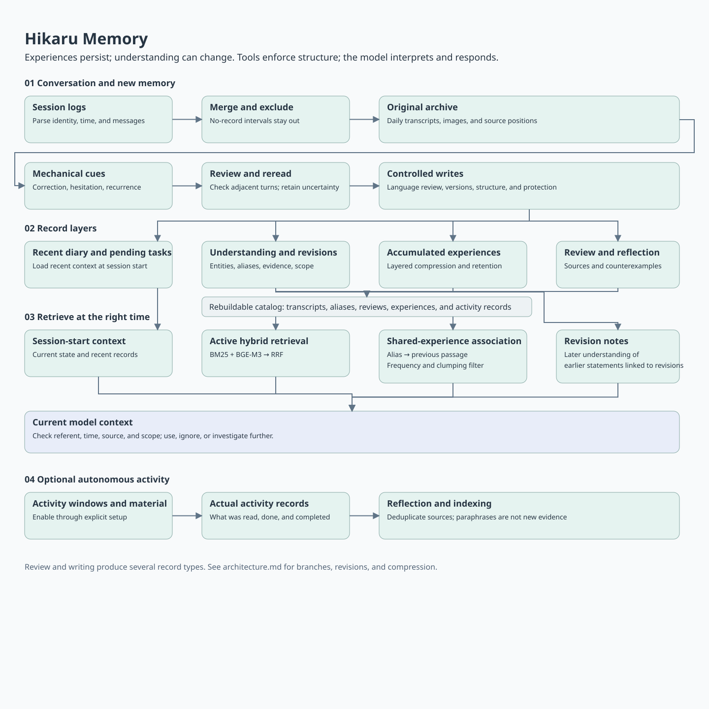
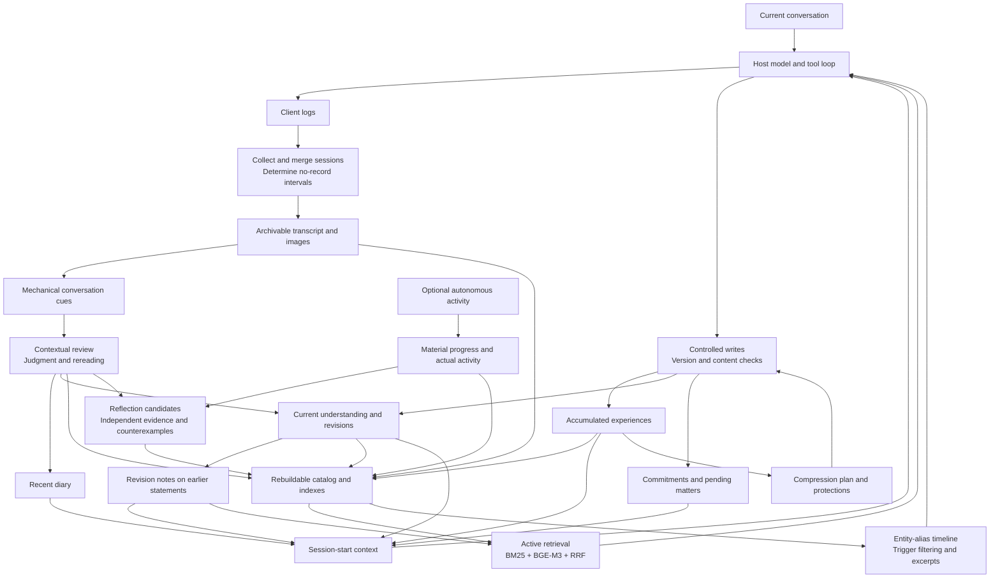

# Hikaru Memory

[中文](README.md) · **English** · [日本語](README.ja.md)

Personal AI memory tools for an ongoing relationship. Hikaru preserves experiences, maintains a current understanding, retrieves relevant history in new conversations, and records why that understanding changed.

**[Known limitations and possible improvements](docs/en/limitations.md)**: current limits, unresolved problems, and possible experiments, followed by historical association-filter results.

**[LoCoMo memory experiment report](docs/en/locomo-2026-11-02.md)**: experiments from October 31 to November 2, 2026, covering transcript retrieval, a full-context baseline, memory consolidation, and conversation review, with the actual prompts, automated scores, and costs.

Hikaru combines a **Haskell core with Python retrieval and support tools**, exposed through a command line to a tool-using model. It currently targets **macOS and Claude Code session logs and hooks**. Consolidation and some background activities require model calls. Memory files, indexes, and activity state are stored locally; anything supplied to a cloud model still enters that provider's context.

This repository contains sanitized source, blank configuration, and integration templates. Users supply their own persona, names, private experiences, no-record phrases, location, and credentials.

## What it is for

Long-term interaction involves more than remembering preferences:

- What was said, and what actually happened in the next turn.
- How the assistant understood it then, and why that understanding changed.
- Which shared experiences are worth reconnecting with, and which need not come up every time.
- Which details may fade, and which commitments, corrections, and experiences should remain.
- What the model has actually read or done, versus what it merely planned or inferred.

For example, “I don't want to go out today” might initially be interpreted as a general dislike of going out. Later conversation may show that the person was simply tired that day. The transcript remains intact; the current understanding can change; earlier statements linked to a revision can be displayed alongside that revision. Repeatedly retrieving or paraphrasing the same statement does not make it multiple independent pieces of evidence.

## Core design

### 1. Separate transcripts, experiences, and understanding

The layers serve different purposes; they are not levels on a single importance scale.

| Function | Structure and purpose | Code name |
|---|---|---|
| Conversation archive | Daily utterances with timestamps, speaker, and session position; images stored separately. Evidence remains unchanged when interpretations change | `tm` / タイムマシン |
| Recent diary | Daily entries organized by week, restoring recent context at session start | `ichifure` |
| Conversation review | Organized by session and turn position; stores contextual judgments, rereadings, and validation of mechanical cues | `ariake` |
| Accumulated experiences | “Recent / earlier / past” layers with dates and retention markers; eligible content can be compressed | `strobe` |
| Current understanding | Markdown entries by entity, with aliases, descriptions, quotations, relationships, dates, and revision chains | `yuugao` |
| Stable commitments and pending matters | Stable commitments in one record; unresolved questions and tasks in another | `oka` / `shiori` |
| Autonomous activity records | Daily activity segments recording actual reading, searching, writing, and execution; material progress and works are stored separately | `michikusa` / `omoigusa` |
| Reflection candidates | Source IDs, original sources of evidence, counterexamples, and later observations; distinguishes resurfacing from new support | `ayame` |

Records are primarily text and JSON. Haskell parses key text formats while preserving their original text. Existing `.b64` files use Base64 encoding, **not encryption**. Catalogs and vector indexes can be rebuilt; they are not the original evidence.

### 2. Understanding can change without rewriting history

There are four kinds of revision: **an earlier misinterpretation, a subsequent change, conflicting evidence, and a condition-dependent difference**.

Revisions carry IDs, evidence, scope, and locations of earlier statements. When earlier records linked to a revision are loaded at session start or retrieved, the tools attach revision notes without altering the originals. Haskell checks structure and reference boundaries; the model judges meaning and context. Types can prevent missing fields, invalid paths, and bypasses of particular write procedures. They cannot prove an interpretation correct.

### 3. Three paths for recall

- **Session-start context** assembles current understanding, recent diary entries, experiences, and pending matters.
- **Active retrieval** uses `omoide` when the model needs past evidence. BM25 lexical retrieval and BGE-M3 semantic retrieval are combined with RRF. Date/source filters and neighboring passages support further searches.
- **Shared-experience association** builds an “entity → sessions where it was mentioned” timeline from aliases in current-understanding entries. A current mention can retrieve a previous passage and deliver at most one short excerpt. The model decides whether to use it.

Automatic association needs selective entry points. General-language frequency and **local clumping** suppress expressions that are both common and dispersed; alias ambiguity is handled separately. Clumping uses Poisson expected coverage calibrated against the empirical distribution of similarly frequent strings. It decides whether an alias should trigger association, **not whether an experience deserves retention, and it does not restrict active retrieval**.

### 4. Review what happened in the conversation before forming reflections

Mechanical tools flag possible corrections, hesitations, enjoyment, recurrence, and other cues. These cues require interpretation. The model checks the transcript and neighboring turns, recording what happened and what remains uncertain.

Conversation review draws on Conversation Analysis (CA). This repository provides cue extraction, judgment storage, and interfaces for subsequent use. Users configure their own analysis procedure; papers and private analysis materials are not included. The [Biblia research map](docs/en/biblia.md) is sanitized and citation-free: it maps questions to research directions, leaving specific literature to the user.

Existing judgments affect the index: a cue explicitly rejected in context loses its importance bonus. Higher-level reflections trace evidence back to its original sources to avoid counting the same source more than once. Rereading the same passage, or reading material derived from one's own reflection, does not automatically add support. Reflections can persist, face counterexamples, or remain unresolved; they do not directly become persona rules.

### 5. Memory compression has explicit limits and protections

Accumulated experiences have capacity and age conditions. Tools calculate the eligible scope and protected content; the model performs compression. Original transcripts remain. Explicit user retention requests, experiences the model marks for retention, and content protected by applicable revisions have their own safeguards.

A retrieval does not automatically mean greater importance. Accessibility, truth, retention value, and usefulness in the current conversation are separate questions.

### 6. Autonomous activity: experience changes the next choice

The optional OwnTime module maintains a persistent decision model for reading, searching, writing, and small programming experiments. The model reports interest, effort, and willingness to continue; the Haskell core updates state, proposes candidates, and calculates budgets and exit conditions.

A material's candidate value is:

$$
V_i=I_i+w_F F_i-S_i-\lambda e_i^2
$$

I estimates interest, F familiarity, S satiation, and e effort. Interest and effort are decay-weighted estimates of historical reports. Exposure increases familiarity and satiation. Familiarity decays over time; satiation declines during time away from the material. Short-term fatigue and daily effort increase λ, the cost of effort. The same book can therefore receive different values after different experiences or in different states.

Three calculations follow:

- **What to choose:** softmax sampling proposes a candidate while preserving exploration. A separate activity ledger tracks time by material origin and adjusts exposure to user-related material, leaving room for independent activities without changing the interest estimates. The model can choose a different candidate.
- **How long to continue:** the value difference between the current material and feasible alternatives, plus willingness to continue, enters a leaky evidence accumulator. The first threshold crossing asks for a new choice; after choosing to continue, a second crossing ends the activity. An explicit wish to stop or rest exits immediately.
- **How much effort remains:** short-term fatigue, daily accumulation, recovery, and limited overspending determine the budget. Reading material already supplied to the model counts toward the budget; pausing or restarting does not reset that usage.

Activities leave records of what was actually read or done, material progress, works, and possible reflections. Records distinguish source content, the author's views, and the assistant's interpretation, as well as completed and unfinished work. Later activities inherit this state.

This module has additional environment dependencies. The repository includes its state machine, tools, and integration templates; installation does not launch a model, configure phone location, or register scheduled jobs.

## Memory processing

| Question | Method | What it determines |
|---|---|---|
| Find relevant history | Character-bigram BM25 + BGE-M3 similarity, combined through RRF | Transcript passages returned by active retrieval |
| Select association triggers | Poisson expected coverage + an empirical same-frequency baseline, with general-language Zipf frequency | Suppression of common, dispersed triggers |
| Reconnect a shared experience | Entity-alias timeline; locate the previous session, then rank within it | At most one short excerpt for the model |
| Give a mechanical cue a bonus | Rule-based importance + existing CA judgments | Rejected cues no longer increase scores |
| Assess additional support | Deduplicate evidence by original source; count support days, counterexamples, and revisions separately | Distinguish resurfacing, support, and revision needs |
| Choose content for compression | Layer capacity, date eligibility, and retention constraints | Editable scope while retaining originals and protected content |

For an alias occurring cf times over N days, uniform random dispersion predicts `N × (1 − exp(−cf/N))` covered days. The empirical distribution of similarly frequent strings calibrates this reference to identify concentration in particular experiences. This score controls association entry points, not truth or retention value.

See [Mathematical models for decisions and memory](docs/en/mechanisms.md) for equations, defaults, state updates, and source locations. Parameters are current engineering choices; interest, context, and evidential relationships still require model judgment.

## Overall flow





[Architecture](docs/en/architecture.md) · [Models and parameters](docs/en/mechanisms.md) · [All tools](docs/en/tools.md) · [Setup](docs/en/setup.md) · [Research map](docs/en/biblia.md) · [Validation](docs/en/validation.md)

## Getting started

Validated environment: **macOS arm64, GHC 9.10.3, Python 3.12.12**. The C compatibility layer and program sandbox depend on macOS. This release does not claim Windows/Linux support.

```bash
cp settings.example.json settings.local.json
# Edit names and your own no-record phrases; location and backup may remain blank.
python3 scripts/configure.py
```

Follow [setup](docs/en/setup.md) to prepare the pinned Haskell dependencies and compile. Basic records and lexical retrieval do not require an embedding model.

```bash
python3 scripts/hikaru fuutou status
python3 scripts/hikaru fuutou show yuugao
python3 scripts/hikaru omoide 'what to look up' --mode lexical
```

Configure the persona and tool-use instructions using the [English host template](templates/en/CLAUDE.md), then connect an authorized log directory. Configuration currently generates from the Chinese template; see the translated-template instructions in setup. Keep private memories and persona files out of this repository.

## Implementation

| Part | Technology | Responsibility |
|---|---|---|
| Core and activity state machine | Haskell, algebraic data types, Megaparsec, Aeson | Day boundaries, record formats, write procedures, revision protections, exclusion intervals, activity state |
| Autonomous decisions | Decay-weighted estimates, state dynamics, softmax, leaky evidence accumulation | Candidate proposals, continuation/exit, fatigue, budget, source balance |
| Retrieval and indexing | Python, BM25, BGE-M3, NumPy, RRF | Transcript chunks, hybrid recall, catalog rebuilding, alias timelines |
| Review and reflection | Tool-using model with explicit source/evidence structures | Interpret interaction, form summaries and hypotheses, identify counterexamples, decide responses |
| Minimal language check | Python character rules, optional fugashi/UniDic | Flag suspicious forms for review without rewriting meaning or voice |
| Optional external inputs | OwnTracks/location events, media state, environmental sensors | Sourced current-state inputs, enabled as needed |

## Release scope

Includes runtime source, third-party notices, blank templates, and synthetic validation scripts. Excludes private memories, chat logs, photos, original persona text, credentials, coordinates, old binaries, and historical Git commits.

Some formats retain Japanese markers and filenames, and tool output and format guidance remain primarily Japanese. These docs explain their functions; this translation does not localize runtime syntax. This is a source release that users can inspect and adapt, not a cross-platform installer. See [validation](docs/en/validation.md).

Licensed under [MIT](LICENSE). Original third-party licenses and notices remain in [third-party](third-party/); see [third-party notes](THIRD_PARTY.en.md).

The presentation of this project was inspired by [lsby/ai-memory](https://github.com/lsby/ai-memory). The projects share some interests but organize and invoke memory differently.
