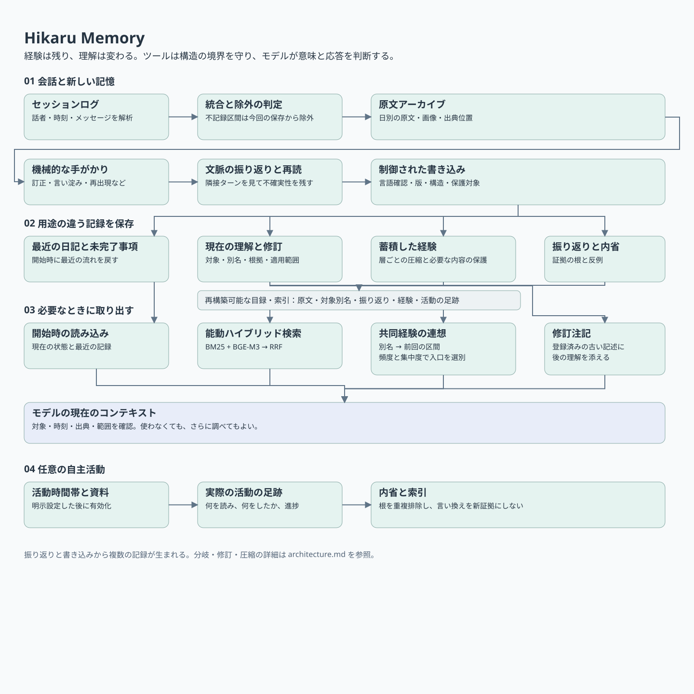
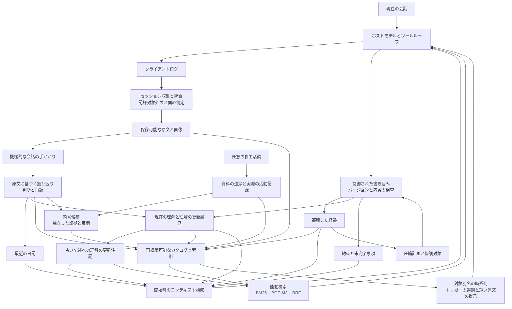

# Hikaru Memory

[中文](README.md) · [English](README.en.md) · **日本語**

継続的な対話を支える個人用 AI の記憶ツールです。経験を保存し、現在の理解を整理して、新しい会話で関連する過去を参照できるようにします。理解が変わった場合には、その理由も記録します。

> **[Hikaru Poetics — 設計の考え方](docs/ja/poetics.md)**
>
> 設計の出発点と俳優の比喩、記憶・入力・継続的なやり取りについての考え方をまとめています。

**[既知の制約と今後の検討事項](docs/ja/limitations.md)**：各モジュールの制約、未解決の問題、検討可能な実験をまとめています。連想トリガーの選別に関する過去のテスト結果は付録にあります。

**[LoCoMo 記憶実験報告](docs/ja/locomo-2026-11-02.md)**：2026年10月31日〜11月2日に行った、原文検索・全文ベースライン・記憶整理・会話振り返りの実験。実際のプロンプト、自動採点、費用を掲載しています。

Hikaru は **Haskell コアと Python の検索・補助ツール**からなり、コマンドライン経由でツールを使えるモデルに接続します。現在は主に **macOS 上で、Claude Code のセッションログとフックを使う構成**を対象としています。記憶の整理や一部のバックグラウンド活動はモデルが行います。記憶ファイル、索引、活動状態はローカルに保存しますが、クラウドモデルに渡した内容は、そのモデルのコンテキストに入ります。

このリポジトリには個人情報を除いたソース、空の設定、接続用テンプレートを収録しています。ペルソナ（役割や口調の設定）、呼び名、私的な経験、記録を停止・再開する合言葉、位置情報、認証情報は利用者が設定します。

## 最近の更新

**2026-11-04 · 表現の繰り返しを知らせる機能**：名前・別名・決まり文句を最近どの程度使ったか、モデルに伝える機能を追加しました。そのまま話す、言い換える、行動に反映する、今は触れない、といった判断の材料になります。接続用テンプレートと集計スクリプトも付属します。利用は任意です。[詳しくはこちら](docs/ja/voice-feedback.md)

## 何を実現したいのか

長く付き合うために必要なのは、「ユーザーの好み」だけではありません。

- そのとき何を話し、次のターンで実際に何が起きたか。
- 当時どう理解し、その後なぜ理解が変わったか。
- 適切な場面で思い出したい共有の経験と、毎回持ち出す必要のない過去。
- 薄れてもよい細部と、残すべき約束、訂正、経験。
- モデル自身が実際に読んだこと・したことと、計画や推測にとどまること。

たとえば「今日は出かけたくない」を「外出が嫌い」と理解してしまい、後の会話で、その日は疲れていただけだと分かることがあります。原文は残し、現在の理解を更新します。登録済みの古い記述を読むときには、その後の理解の変化も併記できます。同じ記述を何度検索したり言い換えたりしても、独立した複数の証拠には数えません。

## 基本設計

### 1. 原文・経験・理解を分けて保存する

各層は用途に応じた区分であり、単一の「重要度」で並べた段階ではありません。

| 機能 | データ構造と用途 | コード上の名前 |
|---|---|---|
| 会話原文のアーカイブ | 時刻・話者・セッション内の位置を持つ日別の発話。画像は別保存。理解が変わっても根拠となる原文を書き換えない | `tm` / タイムマシン |
| 最近の日記 | 週ごとに整理した日別の記録。会話開始時に最近の流れを取り戻す | `ichifure` |
| 会話の振り返り | セッションとターンの位置ごとに、自動抽出した手がかりについて、判断・再読結果・妥当性を記録 | `ariake` |
| 蓄積した経験 | 「このごろ／すこし前／むかし」の層、日付、保持マーカーを持ち、規則に沿って段階的に圧縮 | `strobe` |
| 現在の理解 | 対象別の Markdown 項目。別名、説明、引用した発話、関係、日付、理解の更新履歴を記録 | `yuugao` |
| 長期的な約束と未完了事項 | 長期的な約束は独立した記録に、未解決の質問や用事は別の記録に保存 | `oka` / `shiori` |
| 自主活動の記録 | 日付と活動区間ごとに、実際の読書・検索・執筆・実行を記録。資料の進捗と作品も別保存 | `michikusa` / `omoigusa` |
| 内省候補 | 出典 ID、証拠の出所、反例、後の観察を保持。「再び思い出した」と「新たな支持を得た」を区別 | `ayame` |

主な形式はテキストと JSON です。主要なテキスト形式は Haskell で解析し、元の表記を保持します。既存の `.b64` は Base64 でエンコードしたものであり、**暗号化ではありません**。検索カタログとベクトル索引は記録から再構築でき、元の証拠の役割は担いません。

### 2. 理解を変えても、過去を書き換える必要はない

更新は、**以前の読み違い、その後の変化、証拠の食い違い、条件による違い**の4種類に分けます。

更新には ID、根拠、適用範囲、古い記述の位置を付けます。会話開始時や検索で更新履歴と結び付けた古い記録を読むときには、原文を残して更新内容の注記を添えます。Haskell は構造と参照の境界を検査し、モデルが意味と文脈を判断します。型はフィールドの欠落、不正なパス、特定の書き込み手順の迂回を防げますが、解釈の正しさを証明するものではありません。

### 3. 想起には3つの経路がある

- **開始時の読み込み**：現在の理解、最近の日記、経験、未完了事項を組み合わせ、今回の会話の出発点を作ります。
- **能動検索**：過去の根拠が足りないとモデルが判断したら `omoide` を使います。BM25 による字句検索と BGE-M3 による意味検索の順位を RRF で統合し、日付・出典の範囲指定や隣接区間を使って調べ続けられます。
- **共有した経験の連想**：現在の理解にある別名から「対象 → 以前言及したセッション」の時系列を作ります。今の発話に対象が出たら前回の関連箇所を探し、短い原文を最大1件渡します。使うかどうかはモデルが決めます。

自動連想では、どの表現をトリガーにするかを絞る必要があります。現在は一般的な語の使用頻度と、手元の会話での**集中度（clumping）**を組み合わせ、よく使われ、かつ広く散らばる表現を抑制します。別名の曖昧さは別に扱います。集中度はポアソン分布による期待出現日数を、同程度の頻度の文字列の実測分布で補正します。これは、その別名から自動連想を起動するかを決める値であり、**経験を残す価値は決めず、能動検索も制限しません**。

### 4. 会話で何が起きたかを確かめてから内省する

ツールは規則に基づき、訂正、言い淀み、喜び、同じ表現の再出現などの手がかりを抽出します。あくまで手がかりです。モデルが原文と隣接ターンを読み、起きたことと、まだ分からないことを記録します。

会話の振り返りは会話分析（CA）を参考にしています。本リポジトリは手がかりの抽出、判断の保存、その後の利用インターフェースを提供します。具体的な分析手順は利用者が設定し、論文本文や私的な分析資料は含めません。[Biblia 文献ガイド](docs/ja/biblia.md)は、個人情報と個別文献への参照を除いた文献ガイドです。どの問題にどの研究分野が参考になるかだけを示し、文献自体は利用者が選びます。

既存の判断は索引に反映されます。手がかりが文脈上誤りと明示されていれば、その重要度加点を外します。内省候補では、根拠となる証拠を出所までたどり、互いに独立しているかを管理します。同じ箇所を読み直したり、自分の内省から派生した資料を読んだりしただけでは、新たな支持として数えません。内省候補は、維持することも、反例を受けて見直すことも、判断を留保することもできます。そのままペルソナを規定するルールになるわけではありません。

### 5. 記憶の圧縮に範囲と保護条件を設ける

蓄積した経験には容量と経過日数の条件があります。ツールが整理対象と保護対象を計算し、モデルが圧縮します。原文は残ります。ユーザーが明示的に残すよう求めた内容、モデルが保持対象に指定した経験、有効な理解の更新に関係する内容は、それぞれの仕組みで保護します。

検索された回数だけで重要度を上げることはしません。アクセスしやすさ、真偽、保持する価値、今の会話での用途は別の問題です。

### 6. 自主活動：経験が次の選択に残る

必要に応じて追加できる OwnTime モジュールは、状態を保存する意思決定モデルで読書・検索・執筆・小さなプログラム実験を管理します。モデルが関心、負担、継続意向を報告し、Haskell コアが状態更新、候補提案、予算と終了条件の計算を行います。

資料ごとの候補価値は次の式です。

$$
V_i=I_i+w_F F_i-S_i-\lambda e_i^2
$$

I は関心の推定値、F は資料への馴染み度、S は飽和度、e は負担の強さです。関心と負担は、古い報告ほど重みを下げた加重平均で推定します。資料に触れると馴染み度と飽和度が上がります。馴染み度は時間とともに減衰し、飽和度は資料から離れている間に下がります。短期疲労やその日の累積活動量が増えるほど、負担のコスト係数 λ も上がります。同じ本でも、経験や状態によって候補価値が変わります。

続いて3つの計算を行います。

- **何を選ぶか**：softmax で候補を抽選し、低い評価の候補にも探索の余地を残します。別途、資料の由来ごとに活動量を記録した台帳を使って、ユーザー関連資料の提示比率を調整し、ユーザーに関係しない資料にも触れる余地を残します。関心そのものは書き換えず、モデルは別の候補も選べます。
- **どれだけ続けるか**：現在の資料と実行可能な他候補の価値差と継続意向を、時間とともに過去の影響が弱まる漏洩型の証拠蓄積器に入力します。最初の閾値到達で再選択を求め、続行を選んだ後に再び到達すると終了します。「十分」「休みたい」と明示した場合は直接終了します。
- **あとどれだけ投入できるか**：短期疲労、その日の累積負担、回復、上限付きの予算超過を考慮して活動予算を決めます。すでに提示した読書量は使用量として記録し、中断や再起動でリセットしません。

活動後には、実際に読んだものや行った作業の記録、資料の進捗、作品、内省候補が残ります。資料の内容、著者の見解、自分の理解を区別し、完了と未完了も分けます。次の活動はこの状態を引き継ぎます。

この部分には追加の環境依存があります。状態機械とツールのソース、接続テンプレートを提供しますが、インストール時にモデル起動、スマートフォンの位置情報の設定、定期タスク登録は行いません。

### 7. 経験を覚えていても、同じ言葉を繰り返す必要はない

任意の表現フィードバック機能が、会話開始時とユーザー入力時に、名前・別名・定型表現の最近の使用状況を伝えます。保護対象の原文には別の注意書きを添え、保存の必要性を回数では決めません。そのまま言うか、言い換えるか、選択に反映するか、今回は触れないかはモデルが判断します。返答を自動修正する機能ではありません。[仕組みと接続方法](docs/ja/voice-feedback.md)を参照してください。

## 記憶処理

| 問題 | 方法 | 決めること |
|---|---|---|
| 関係する過去を探す | 文字2-gram BM25 + BGE-M3、RRF で順位統合 | 能動検索で返す原文区間 |
| 連想を起こす表現を選ぶ | ポアソン分布による期待出現日数 + 同頻度文字列の実測分布、一般的な使用頻度を表す Zipf 値 | 日常的に広く使われる表現をトリガーから除外 |
| 過去のどの経験につなぐか | 対象別名の時系列で前回のセッションを探し、内部で順位付け | モデルに渡す最大1件の短い区間 |
| 手がかりを加点するか | 規則による重要度 + 既存の CA 判断 | 誤りと判定済みの手がかりは加点しない |
| 理解が新たに支持されたか | 証拠の出所を重複排除し、支持日・反例・更新を別に数える | 再浮上、支持、更新の必要性の区別 |
| どの経験を圧縮するか | 層ごとの容量、日付条件、保護制約 | 原文と保護内容を残した整理範囲 |

たとえば N 日で cf 回出現する別名が一様にランダム分布すると、出現日数の期待値は `N × (1 − exp(−cf/N))` です。同頻度の文字列の実測分布でさらに補正し、特定の経験に集中しているかを見ます。この値は連想のトリガーの選別にだけ使い、真偽や保持する価値の点数にはしません。

式、既定値、状態更新、ソース位置は[意思決定と記憶の数理モデル](docs/ja/mechanisms.md)にまとめています。パラメータは現在の実装上の設定であり、関心・文脈・証拠関係はなおモデルが判断します。

## 全体の流れ





[構造と詳細フロー](docs/ja/architecture.md) · [数理モデルとパラメータ](docs/ja/mechanisms.md) · [全ツール](docs/ja/tools.md) · [導入](docs/ja/setup.md) · [文献ガイド](docs/ja/biblia.md) · [検証](docs/ja/validation.md)

## 使い始める

検証環境は **macOS arm64、GHC 9.10.3、Python 3.12.12** です。C 互換層と小規模プログラムの実行用サンドボックスは macOS に依存し、この版では Windows/Linux 対応をうたっていません。

```bash
cp settings.example.json settings.local.json
# 呼び名と自分用の不記録の合言葉を設定。位置とバックアップは空欄でも構いません。
python3 scripts/configure.py
```

[導入手順](docs/ja/setup.md)に従ってバージョンを固定した Haskell パッケージを用意し、コンパイルします。基本の記録操作と字句検索に埋め込みモデルは不要です。

```bash
python3 scripts/hikaru fuutou status
python3 scripts/hikaru fuutou show yuugao
python3 scripts/hikaru omoide '調べたいこと' --mode lexical
```

[日本語のホストテンプレート](templates/ja/CLAUDE.md)でペルソナとツールの利用方針を記入し、許可したログディレクトリに接続してください。設定スクリプトは現在、中国語テンプレートを使うため、日本語版の利用手順は導入文書を参照してください。元の運用環境の記憶やペルソナファイルをこのリポジトリに混ぜないでください。

## 実装の分担

| 部分 | 技術 | 担当 |
|---|---|---|
| コアと活動状態機械 | Haskell、代数的データ型、Megaparsec、Aeson | 日界、記録形式、書き込み手順、理解の更新に伴う保護、除外時間帯、活動状態 |
| 自主活動の判断 | 減衰加重推定、状態更新、softmax、漏洩型の証拠蓄積 | 資料提案、継続・終了、疲労と予算、資料の偏りの調整 |
| 検索と索引 | Python、BM25、BGE-M3、NumPy、RRF | 原文分割、ハイブリッド検索、カタログ再構築、別名時系列 |
| 振り返りと内省 | ツールを使うモデル、明示的な出典・証拠のデータ構造 | 相互行為の解釈、要約と仮説、反例の認識、応答判断 |
| 最小言語チェック | Python の字形規則、任意の fugashi/UniDic | 疑わしい表記を示し再確認を求める。意味や口調は自動で書き換えない |
| 任意の外部入力 | OwnTracks/位置イベント、メディア状態、環境センサー | 情報源を確認できる現在の状況を必要に応じて入力 |

## 公開範囲

実行用ソース、第三者の著作権表示、空のテンプレート、合成データを使う検証スクリプトを含みます。私的な記憶、会話ログ、写真、元のペルソナ設定、認証情報、座標、古いバイナリ、過去の Git 履歴は含みません。

データ形式の一部は元の日本語マーカーとファイル名を保ち、ツールの出力・書式案内も主に日本語です。文書では機能との対応を示しています。これは既存の実装を確認・利用できるソース公開版であり、クロスプラットフォームのインストーラーではありません。[検証記録](docs/ja/validation.md)も参照してください。

[MIT ライセンス](LICENSE)で公開します。第三者のライセンスと表示は [third-party](third-party/) に保持しています。[第三者コードについて](THIRD_PARTY.ja.md)も参照してください。

紹介の構成は [lsby/ai-memory](https://github.com/lsby/ai-memory) を参考にしました。関心の重なる部分がありますが、記憶の構成と呼び出し方は異なります。
