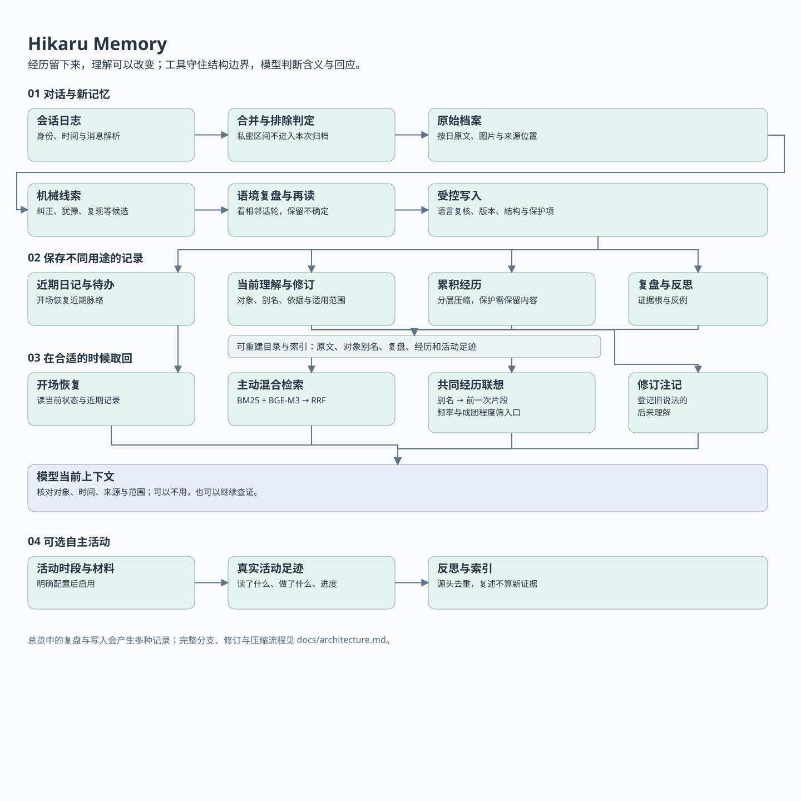
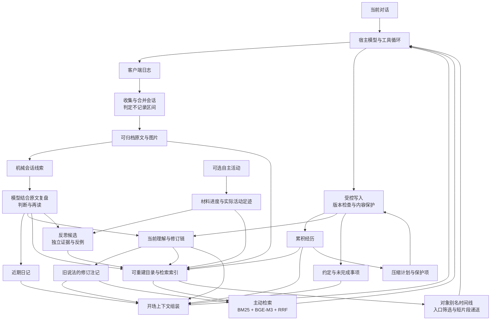

# Hikaru Memory

一套用于持续相处的个人 AI 记忆工具。它保存经历、整理当前理解、在新对话里找回相关的过去，也记录理解为什么改变。

Hikaru 由 **Haskell 核心 + Python 检索与辅助工具**组成，通过命令行接入能够调用工具的模型。目前主要适配 **macOS、Claude Code 的会话日志与 hook**；主动整理和部分后台活动由模型完成。记忆文件、索引和活动状态保存在本地，交给云端模型的内容仍会进入对应模型的上下文。

这个仓库提供脱敏源码、空白配置和接入模板。角色、称呼、私人经历、不记录口令、地理位置及服务凭据都由使用者自己填写。

## 想解决什么

长期相处需要保存的，不只是“用户喜欢什么”，还包括：

- 当时说了什么，下一轮实际发生了什么。
- 我当时怎么理解，后来为什么改变理解。
- 哪些共同经历值得在合适的时候接上，哪些旧事不用每次都提。
- 哪些细节可以淡去，哪些约定、修正和经历需要留下。
- 模型自己读过、做过什么，以及哪些只是计划或猜测。

例如，模型曾把“今天不想出去”理解成“不喜欢出门”。之后的交流可能表明，这只是那天累了。原始对话保留；当前理解可以修订；以后读到登记过的旧说法时，可以同时看到后来的修正。系统不会因为一个说法被自己多次检索、复述，就把它当成多份独立证据。

## 核心设计

### 1. 原文、经历与理解分开保存

这里的层次是用途不同，不是统一的“重要性分数”。

| 功能 | 数据结构与用途 | 代码中的名称 |
|---|---|---|
| 原始对话档案 | 按日保存的逐条发言，含时间、说话者、会话位置；图片另存。用于查证，不因理解变化重写 | `tm` / タイムマシン |
| 近期日记 | 按周组织、按日记录；用于开场恢复近期生活脉络 | `ichifure` |
| 对话复盘 | 以会话及话轮位置组织；机械线索旁记录模型的判断、再读与线索是否成立 | `ariake` |
| 累积经历 | 分为“最近／稍早／过去”；有日期和保留标记，可按规则逐步压缩 | `strobe` |
| 当前理解 | 按对象组织的 Markdown 条目；可含别名、描述、原话、关联、日期及修订链 | `yuugao` |
| 稳定约定与未完成事项 | 稳定约定单独保存；尚待询问、处理的事情放入另一份记录 | `oka` / `shiori` |
| 自主活动记录 | 按日、按活动片段记录实际阅读、搜索、写作与执行；另存材料进度和作品 | `michikusa` / `omoigusa` |
| 反思候选 | 来源 ID、证据根、反例及后续观察；区分“再次想起”与“新证据支持” | `ayame` |

数据文件主要是文本与 JSON；Haskell 对关键文本格式做保留原文的解析。现有 `.b64` 文件使用 Base64 包装，**这不是加密**。检索目录、向量索引可以从记录重建，不承担原始证据的职责。

### 2. 理解可以改变，历史不必被改写

修订分成四种：**之前理解错了、后来发生了变化、两份证据冲突、只在特定条件下成立**。

修订记录带编号、依据、适用范围及旧说法所在位置。开场和检索读到登记过的旧记录时，附上修订说明；原文仍保留。Haskell 检查修订结构和引用边界，模型判断内容与语境。类型能防止缺字段、错误路径和绕过特定写入流程，不能证明模型的解释正确。

### 3. 召回有三条路径

- **开场恢复**：组装当前理解、近期日记、经历与待办，建立这次对话的起点。
- **主动检索**：模型发现缺少过去的依据时，调用 `omoide`。BM25 字面检索和 BGE-M3 语义检索通过 RRF 合并排名；支持日期范围、来源范围与相邻片段，模型可继续查找。
- **共同经历联想**：从当前理解条目的别名建立“对象 → 曾经提及的会话”时间线。当前提到一个对象时，找出前一次相关片段，最多递一条短材料。模型决定是否使用。

自动联想需要控制入口。现在会结合一般语言频率和本地语料中的**成团程度**，抑制常见又分散的说法；同名歧义另行处理。成团分数参考泊松覆盖率，再以同频字串的实际分布校准。它决定某个别名是否适合触发自动联想，**不决定一段经历是否值得保留，也不限制主动检索**。

### 4. 先看对话发生了什么，再形成反思

机械工具会标出可能的纠正、犹豫、愉快、复现等线索。这些只是候选。模型在原文和相邻话轮里复核，写出发生了什么以及哪里仍不确定。

对话复盘的设计参考会话分析（CA）。本仓库提供线索提取、判断存储及后续使用接口；具体分析规程需由使用者配置，不附带论文原文与私人分析材料。[Biblia 文献导航](docs/biblia.md)提供脱敏、去引用化的问题地图，只说明遇到哪类问题可以参考什么方向的研究；具体文献由使用者自行选择。

已有判断会进入索引：某个线索已明确被判错，就移除由它带来的重要度加分。更高层的反思候选追踪独立证据根；反复读同一段、读取由自己反思派生的材料，不自动算作新支持。反思可以留下、受反例影响或继续悬而未决，不直接变成新的性格规则。

### 5. 淡化是有边界的整理

累积经历有容量与时间条件。工具计算哪些内容进入整理范围、哪些受保护，再让模型压缩；原始对话仍保留。用户明确要求保留、模型标为需要保留的经历，以及仍受修订保护的相关内容，有各自的保护机制。

“被检索了一次”没有被统一等同于“更重要”。记忆的可访问性、真实性、保留价值和对当前对话的用途，是不同的问题。

### 6. 自主活动：经历会改变下一次选择

可选的 OwnTime 模块用一个持续保存状态的决策模型管理阅读、搜索、写作和小程序试验。模型报告兴趣、负担和继续的意愿；Haskell 核心据此更新状态、提出候选、计算预算和退出条件。

每份材料的候选价值为：

$$
V_i=I_i+w_F F_i-S_i-\lambda e_i^2
$$

其中 I 是兴趣估计，F 是熟悉程度，S 是饱足程度，e 是负担。兴趣和负担由历史报告做衰减加权估计；接触使材料更熟悉，也积累饱足，离开后两者以不同速度下降。短期疲劳和日内投入会提高负担代价 λ。因此，同一本书即使内容不变，也可能在不同经历和状态下获得不同的候选价值。

随后有三层计算：

- **选择什么**：用 softmax 按价值抽样提议，保留探索较低分候选的机会。独立的来源账本调节与用户相关材料的曝光，让自由活动保留自己的范围；这个调节不改写兴趣。模型仍可选择其他候选。
- **继续多久**：将当前材料与其他可行选择比较，把价值差和继续意愿送入带泄漏的证据累积器。第一次越线要求重新选择，选择继续后再次越线则结束；明确说够了或想休息时直接退出。
- **还能投入多少**：短期疲劳、日内累积、恢复和有限的超额投入共同决定预算。已经交付的阅读量会记账，暂停或重启不会把它清零。

活动之后留下实际读过、做过的足迹，以及材料进度、作品和可能的反思。记录区分材料内容、作者观点和自己的理解，也区分实际完成与尚未完成。下一次活动会继承这些状态。

这部分包含更多运行环境依赖。仓库保留状态机与工具源码，提供接入模板；不会在安装时替使用者启动模型、配置手机定位或注册定时任务。

## 记忆处理

不同问题使用各自的计算口径：

| 问题 | 方法 | 决定什么 |
|---|---|---|
| 找到有关的过去 | 字符二元组 BM25 + BGE-M3 向量相似度，RRF 合并排名 | 主动检索返回哪些原文片段 |
| 哪些说法适合触发联想 | 泊松预期覆盖率 + 同频字串的经验基准，结合一般语言 Zipf 词频 | 抑制常见、分散的自动联想入口 |
| 接上哪一次共同经历 | 对象别名时间线，先定位前一次会话，再在会话内排序 | 最多递一条短片段供模型取用 |
| 机械线索是否应加分 | 规则重要度 + 已有 CA 判决 | 已被判错的线索不再抬高分数 |
| 一种理解是否得到更多支持 | 独立证据根去重，支持日、反例和修订分别计数 | 区分再次想起、得到支持、需要修订 |
| 哪些经历进入压缩 | 分层容量、日期资格和保留约束 | 生成可整理范围，保留原文与受保护内容 |

例如，某个别名在 N 天里出现 cf 次，均匀随机散布时的预期覆盖天数为 `N × (1 − exp(−cf/N))`。系统再用同频字串的实际分布校准，判断它是否特别集中于某几段经历。这个分数只管理联想入口，不作为真实性或保留价值的分数。

完整公式、默认参数、状态更新与源码位置见[决策与记忆中的数学模型](docs/mechanisms.md)。这些参数是当前工程设定；兴趣、语境和证据关系仍需模型判断。

## 整体流程



下面是可直接在 GitHub 展开的流程图，详细分支见架构文档。



[详细流程与数据结构](docs/architecture.md) · [数学模型与参数](docs/mechanisms.md) · [全部工具索引](docs/tools.md) · [安装与配置](docs/setup.md)

## 开始使用

当前验证环境：**macOS arm64、GHC 9.10.3、Python 3.12.12**。C 兼容层与小程序沙盒依赖 macOS；这版没有声称支持 Windows/Linux。

```bash
cp settings.example.json settings.local.json
# 编辑 settings.local.json：填写称呼和自己的不记录口令；位置和备份可留空
python3 scripts/configure.py
```

按[安装说明](docs/setup.md)准备锁定的 Haskell 依赖并编译。基础记录与字面检索不需要下载嵌入模型。

```bash
python3 scripts/hikaru fuutou status
python3 scripts/hikaru fuutou show yuugao
python3 scripts/hikaru omoide '想查的事' --mode lexical
```

之后自行将 `templates/CLAUDE.md` 中的角色和工具约定补齐，再接入授权处理的日志目录。不要直接把原部署的记忆或角色文件混入这个代码仓库。

## 实现分工

| 部分 | 技术 | 负责什么 |
|---|---|---|
| 核心与活动状态机 | Haskell、代数数据类型、Megaparsec、Aeson | 日期边界、记录格式、写入流程、修订保护、排除时段与活动状态 |
| 自主活动决策 | 衰减加权估计、状态动态、softmax、带泄漏的证据累积 | 材料提议、继续与退出、疲劳与预算、来源平衡 |
| 检索与索引 | Python、BM25、BGE-M3、NumPy、RRF | 原文切片、混合召回、目录重建、别名时间线 |
| 会话整理与反思 | 工具调用模型、明确的来源与证据结构 | 解释互动、形成摘要与假设、识别反例、决定怎样回应 |
| 语言最小检查 | Python 字形规则、可选 fugashi/UniDic | 标出可疑写法，要求复核；不自动重写含义与口吻 |
| 可选外部输入 | OwnTracks/位置事件、媒体状态、环境传感器 | 提供有来源的当前状态，按需启用 |

## 发布范围

包含运行源码、第三方版权说明、空白模板、合成验证脚本。没有私人记忆、聊天日志、照片、人设原文、账户凭据、坐标、旧二进制或历史 Git 提交。

一些数据格式仍保留原来的日文标记和文件名，工具输出与格式提示也以日语为主；文档给出了功能对应关系。这是现有实现的可审阅源码版，尚未做成跨平台安装器。验证范围见 [本地验证记录](docs/validation.md)。

项目采用 [MIT 协议](LICENSE)。第三方代码的原有许可和版权声明保留在 [third-party](third-party/)；说明见 [THIRD_PARTY.md](THIRD_PARTY.md)。

项目介绍的组织方式参考了 [lsby/ai-memory](https://github.com/lsby/ai-memory)。两个项目关注点有交集，也采用了不同的记忆组织与调用方式。
