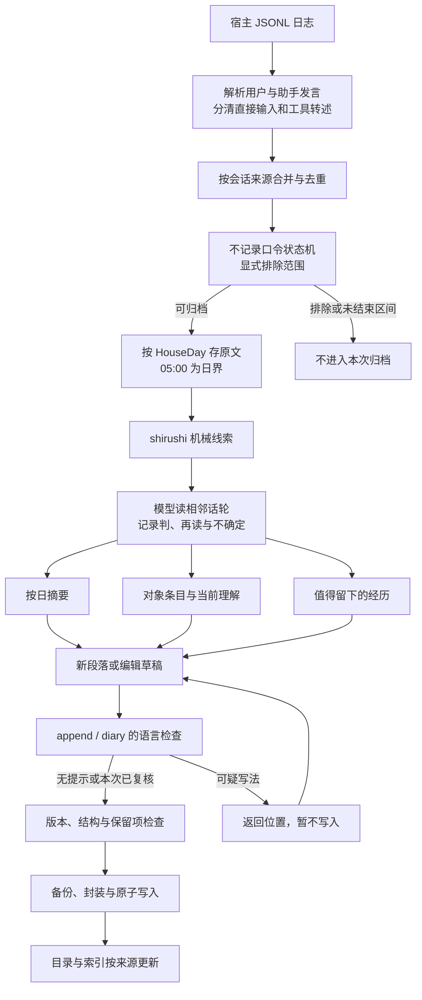
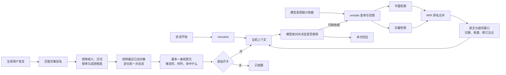
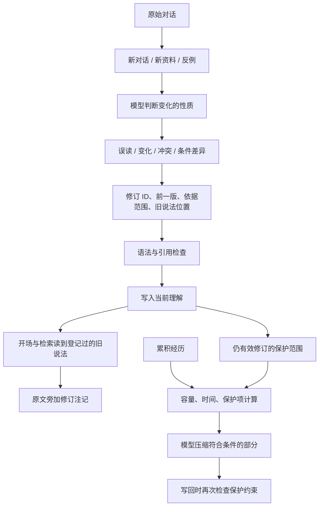
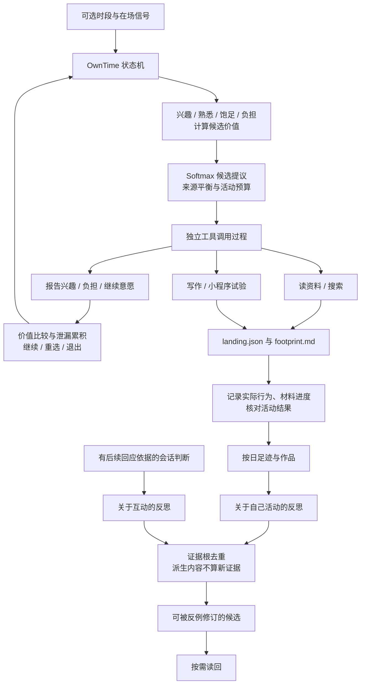

# 数据结构与详细流程

## 谁负责什么

宿主模型负责理解、取舍与表达；工具负责保存、定位、检查已明确的结构边界。系统没有一个能判断所有语义正确性的总评分。机械线索、CA 判断、检索相关性、反思证据和压缩保护是不同的数据。

## 一次新经历怎样留下来



`HouseDay` 是按日本时间早上 5 点切分的日子。现在这是实现约定，不是 JSON 中可随意调整的选项。不记录口令匹配整条符合条件的用户输入；并不等于从客户端、供应商或其他备份中删除消息。

### 主要记录格式

以下都是合成的结构示意，字段名称有语法意义，不能仅为美观翻译后写回。

**当前理解条目**：标题与别名让检索找到对象，说明和原话保存模型理解及其依据，修订属于条目内部。

```markdown
## もの
### 例子的对象
- 別名：青い箱、収納箱
- 説明：机の横に置く箱。
- 日付：2026-10-30
```

**累积经历**：`## むかし`、`## すこし前`、`## このごろ` 是三个层次，内部按日期组织。`（ねゆき）` 与 `（いけび）` 是不同来源的保留标记。具体保留、追加与压缩约束由 `Memory/Strobe.hs`、`FadePolicy.hs`、`Store/EditPlan.hs` 处理。

**会话复盘**：`## ひととき` 标出会话块，`###` 标出位置，`判：`、`再読：`、`しるし：` 保存初判、再读和机械线索的复核。实际的判断是模型写的；工具负责读取这些已存在的结论，避免判错的线索仍在评分中生效。

**可重建目录**：记录来源、日、会话、说话者、片段位置和内容指纹；对象条目关联其别名出现过的原文位置。目录不是新的事实来源，也不是把所有关联当作因果关系的知识图谱。

## 三种召回怎样汇合



字面或向量相似不代表“增量用途”已经成立。“前一次提到某个词”也不保证就是同一件东西。系统给模型保留核对对象、时间和语境的机会。

成团分数以天为文档，观察字串频数和覆盖天数，并用语料内的参照分布校准。一般词频不明或出现很少的别名，按现有保守策略处理。它只影响自动联想入口；阈值来自原部署实验，不保证换一个人的语料仍然最优。

## 修订与淡化



写入保护不等于全部文件永久不可改。累积经历的追加、正常修订、语言定点修复及压缩各有入口；`--force` 不是日常语言提示的通用绕过参数。语言复核的 `--lang-ok` 只作用于该次语言检查，不能跳过核心版本或内容保护。

## 自主活动与反思



这部分同时含有确定性的活动状态机和模型判断。`_ayame.py` 的来源分类、候选生成会调用外部模型；空白模板不自动复制原部署的角色、阅读计划与调度。完整字段定义见 `OwnTime/Reflection.hs`、`Michikusa.hs`、`Records.hs`、`Types.hs` 及 `Tokimori.hs`。

活动价值、候选抽样、继续/退出累积，以及检索、成团筛选和证据计数，详见[数学模型与参数](mechanisms.md)。
