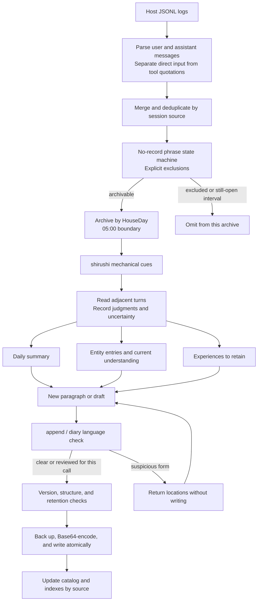
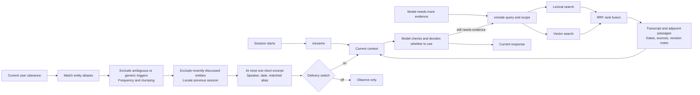
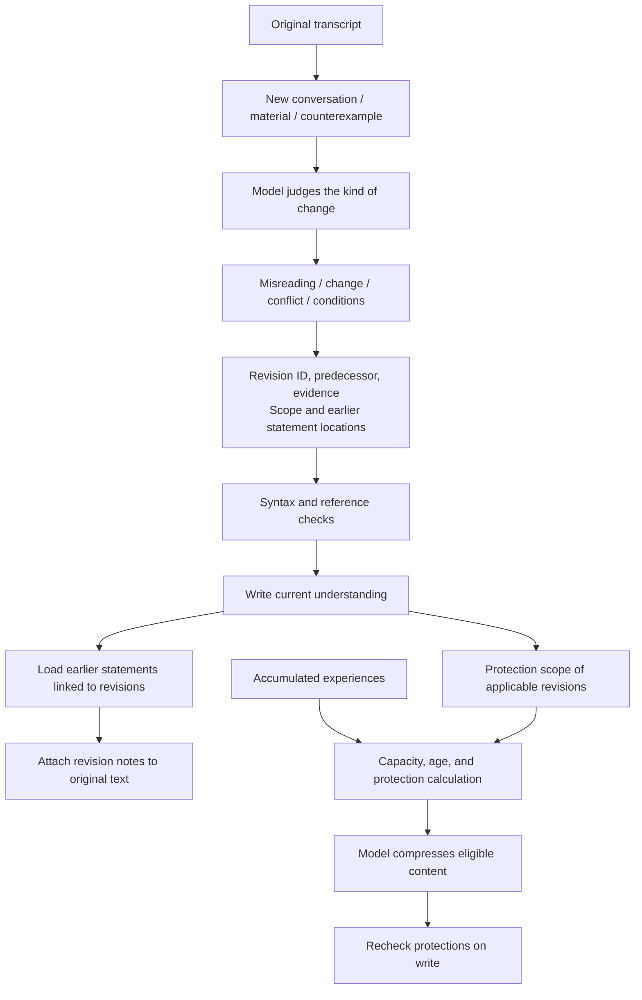
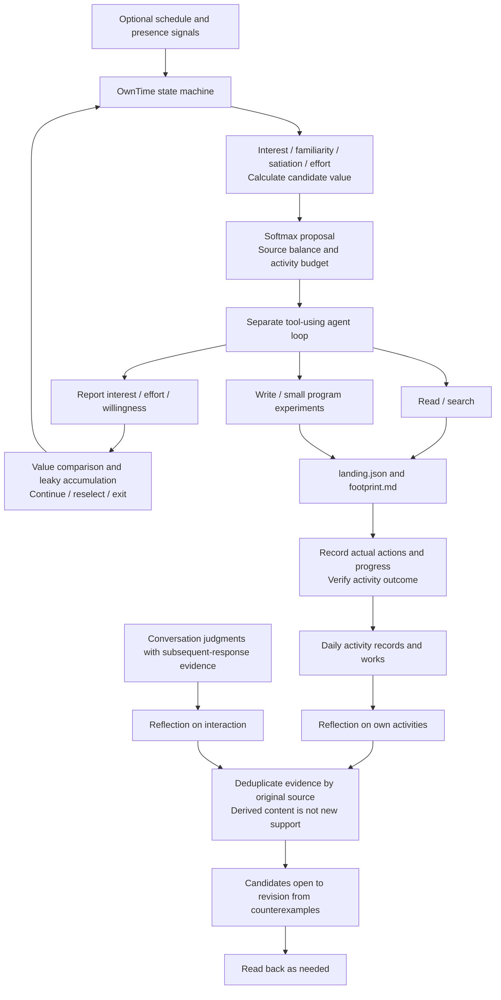

# Data structures and detailed flow

[中文](../architecture.md) · **English** · [日本語](../ja/architecture.md) · [Home](../../README.en.md)

## Responsibilities

The host model interprets evidence, selects material, and generates responses. Tools store and retrieve records and enforce explicit structural constraints. There is no universal score for semantic correctness. Mechanical cues, CA judgments, retrieval relevance, reflection evidence, and compression protections are separate kinds of data.

## How a new experience is recorded



`HouseDay` divides days at 05:00 Japan time. This is an implementation convention, not a freely configurable JSON option. No-record phrases match whole qualifying user inputs; they do not delete messages from the client, provider, or other backups.

### Main record formats

These are synthetic structural examples. Field names are part of the record format; do not translate them when writing records.

**Current-understanding entry:** headings and aliases locate the entity; descriptions and quotations hold interpretation and evidence; revisions belong inside the entry.

```markdown
## もの
### Example entity
- 別名：青い箱、収納箱
- 説明：机の横に置く箱。
- 日付：2026-10-30
```

**Accumulated experiences:** `## むかし`, `## すこし前`, and `## このごろ` are the three layers, organized internally by date. `（ねゆき）` and `（いけび）` are retention markers with different origins. `Memory/Strobe.hs`, `FadePolicy.hs`, and `Store/EditPlan.hs` enforce retention, append, and compression constraints.

**Conversation review:** `## ひととき` marks a session block, `###` a position, and `判：`, `再読：`, `しるし：` hold initial judgments, rereadings, and cue validation. The model writes the judgments; tools consume them so that rejected cues no longer affect scoring.

**Rebuildable catalog:** stores source, day, session, speaker, passage position, and content fingerprint. Entity entries link to alias occurrences in transcripts. The catalog is neither a new factual source nor a knowledge graph treating every association as causation.

## How the three recall paths meet



Lexical or semantic similarity does not establish incremental usefulness. The previous occurrence of a word does not guarantee the same referent. The model can check the entity, time, and context before using a passage.

Clumping treats days as documents, relates string frequency to days covered, and calibrates against the corpus distribution. Low-frequency aliases and aliases with unknown general-language frequency are not excluded by this filter. The score only controls automatic triggers; thresholds explored in one deployment need not be optimal for another person's corpus.

## Revision and memory compression



Write protection does not make every file permanently immutable. Appending experiences, normal revision, targeted language repairs, and compression have distinct entry points. `--force` is not a general bypass for routine language warnings. `--lang-ok` acknowledges only that call's language check; it cannot bypass core version or content protection.

## Autonomous activity and reflection



This combines a deterministic activity state machine with model judgments. Source classification and candidate generation in `_ayame.py` call an external model. Blank templates do not reproduce the original deployment's persona, reading plan, or schedule. Field definitions are in `OwnTime/Reflection.hs`, `Michikusa.hs`, `Records.hs`, `Types.hs`, and `Tokimori.hs`.

See [models and parameters](mechanisms.md) for candidate values, sampling, continuation/exit accumulation, retrieval, clumping, and evidence counts.
