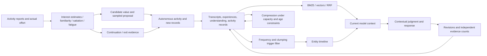

# Mathematical models for decisions and memory

[中文](../mechanisms.md) · **English** · [日本語](../ja/mechanisms.md) · [Home](../../README.en.md)

This document describes calculations in the released source. Defaults are engineering choices to reassess against actual use, not psychological constants measured from a person. The model supplies interest, effort, willingness, and contextual judgments; the program updates state, samples candidates, manages budgets, and enforces structural constraints.

## I. Autonomous activity: stateful choice and continuation

Main implementations: [Engine.hs](../../.tools/haskell-src/src/Hikaru/OwnTime/Engine.hs) and [Fatigue.hs](../../.tools/haskell-src/src/Hikaru/OwnTime/Fatigue.hs). Each material has its own state. The activity process also retains fatigue, effort-weighted time, accumulated evidence for continuing, and an activity ledger organized by material origin.

### 1. Candidate value: interest, familiarity, satiation, and effort

For material i:

$$
V_i = I_i + w_F F_i - S_i - \lambda e_i^2
$$

| Quantity | Meaning | Source |
|---|---|---|
| I | Estimated interest, 0–1 | Model reports after exposure and historical estimates |
| F | Familiarity, 0–1 | Contact history with the same material |
| S | Satiation, 0–1 | Accumulates during exposure, declines when away |
| e | Effort intensity, 0–1 | Model report, or an estimate accompanied by the reason a report is unavailable |
| λ | Current cost coefficient for effort | Short-term fatigue and within-day accumulation |
| w_F | Positive contribution of familiarity | Default 0.3 |

Familiarity can make previously enjoyed material easier to approach, while repeated exposure can temporarily reduce its appeal. Effort enters quadratically, so fatigue affects demanding material more strongly. V is an engineering quantity for choice and comparison.

### 2. Updating interest and effort from reports

`estimateAt` uses a decay-weighted mean with a neutral prior:

$$
w_j=2^{-\Delta\mathrm{days}_j/14},\qquad
\hat\mu=\frac{0.5+\sum_j w_j y_j}{1+\sum_j w_j}
$$

New candidates default to 0.5 for interest and effort. Reports update the estimate; older observations weaken, pulling it toward 0.5. With no observations, the function returns missing, and the caller uses an existing material estimate or the new-candidate default.

**Missing is not zero.** An unasked question, absent answer, or interruption can fall back to an estimate with a reason; that estimate is not recorded as a fresh report. This is a point estimate with prior shrinkage, not a credible interval or an update of language-model weights.

### 3. Familiarity and satiation change at different rates

On a new contact with the material:

$$
F^+=F+a_F(1-F),\qquad S^+=S+a_S(1-S)
$$

Defaults: a_F = 0.08, a_S = 0.10. Repeated registration of the same material's entry point does not create independent candidates.

Familiarity decays over calendar time, including time spent in contact:

$$
F(t+d)=F(t)\,2^{-d/(21\times1440)}
$$

Here and below, d is in minutes. Away from the material, satiation has a two-day half-life:

$$
S(t+d)=S(t)\,2^{-d/(2\times1440)}
$$

During continued contact, satiation approaches an equilibrium:

$$
a=\frac{\ln2}{360},\quad b=\frac{\ln2}{2\times1440},\quad
S_{eq}=\frac{a}{a+b}=\frac89
$$

$$
S(t+d)=S_{eq}+(S(t)-S_{eq})e^{-(a+b)d}
$$

F and S are **states of activity materials**. They do not determine transcript deletion, retention, or credibility.

### 4. Short-term fatigue, daily accumulation, and budgets

An activity contributes ΔE = e·d, its duration weighted by effort intensity. We call this unit an effort-minute. Short-term fatigue R updates during work and rest as follows:

$$
R_{work}=1-(1-R)2^{-\Delta E/60},\qquad
R_{rest}=R2^{-d/25}
$$

Slower daily accumulation:

$$
U_{live}=1-(1-U_m)2^{-E_{day}/120}
$$

Effort cost depends on both:

$$
\lambda=0.5+2(R+U_{live})
$$

The day's starting U_m is the maximum of recovered U, existing overspending debt D/120, and that day's one-time state self-report. Missing self-reports are not filled with zero; repeated requests for a self-report cannot replace it with a more favorable value. The starting value freezes at the first actual effort of the day.

The base daily budget is B_day = 120(1−U_m). Excess effort becomes debt, capped at 120. Qualifying quiet time at night reduces U and debt with half-lives of 180 and 240 minutes respectively; debt below 5 is cleared after recovery. Short daytime breaks mainly restore R rather than erasing the day's effort.

Reading also has a separate daily cap of 480 equivalent minutes. The current segment's allowance is:

$$
Q=\max\left(0,\min(25-A_{advance},\;480-T_{read},\;E_{room})\right)
$$

- A_advance is the amount of reading material already supplied to the model that has not yet been offset by elapsed time, tracked in a queue for each material.
- T_read is the day's used equivalent reading time.
- E_room is remaining effort capacity, including the implementation's limited debt allowance.

Reading time and effort are charged once when material is supplied, not again as time elapses. Pausing, restarting, or moving to a new day does not erase material supplied in advance. Writing and making things consume effort but not reading allowance: inability to read more does not prohibit all other activities.

Default conversion rates are 650 Japanese characters/minute, 390 Chinese characters/minute, and 250 English words/minute, with genre coefficients. This is budget accounting, partly dependent on agent reports, not a measurement of actual comprehension.

### 5. Softmax sampling: which candidate to propose

Temperature τ = 0.175, with a separate source-balancing factor g_i:

$$
P(i)=\frac{g_i\exp(V_i/\tau)}{\sum_j g_j\exp(V_j/\tau)}
$$

A numerically stable softmax and random seed select a proposal. The agent receives the candidate table, values, and weights. **A proposal does not compel it to accept the sampled material.**

Source balancing reserves room for independent activities. Let A_rel be weighted effort-minutes related to the user and B_known all weighted effort-minutes with known sources:

$$
E_{src}=A_{rel}-0.2B_{known}
$$

$$
g=1-\frac23\mathrm{clip}_{[0,1]}(E_{src}/100)
$$

User-related candidates receive g; others receive 1. Their weight can fall to one-third but never to zero. Unknown-source effort is accounted for separately, not labeled unrelated. The ledger uses a 2.5-day half-life. Effort added during activity is integrated with decay calculated from the time it was expended.

The implementation adds τ·ln(g) to the value used in sampling logits, equivalent to multiplying the weights above. This **only changes candidate exposure**, not interest or the continuation/exit evidence below.

### 6. Continue or leave: leaky evidence accumulation

At each decision point during an activity, compare the current material with feasible alternatives.

Alternatives are weighted by softmax without source balancing. The comparison uses their values after the next contact, V_i⁺, and assigns rest a value of zero:

$$
V_{else}=\max\left(0,\sum_i p_i V_i^+\right)
$$

With no alternatives, V_else = 0. `newContact` applies only if the next step is a new contact; multiple entries for the same material are deduplicated first.

The evidence value m at each decision point combines willingness and the difference in candidate values:

$$
z=\tanh\left(\frac{V_{here}-V_{else}}{0.25}\right),\qquad
m=0.25s_{self}+0.75z
$$

Explicit willingness to continue/look again gives s_self = 1; uncertainty gives 0. Without a willingness report, use m = z, distinguishing missing from reported uncertainty. “Enough” or “rest first” exits immediately without waiting for the accumulator.

For actual activity duration d:

$$
\rho(d)=2^{-d/60},\qquad K=\frac{0.5}{1-2^{-25/60}}
$$

$$
x'=\mathrm{clip}_{[-1,1]}\left(\rho(d)x+K[1-\rho(d)]m\right)
$$

During a pause, only the old x decays; no new evidence is added. Within a constant-m interval, this integrated form avoids changing the result merely by splitting time into smaller segments. There is no extra random diffusion term; randomness mainly comes from candidate sampling.

At x ≤ −0.15, the first crossing requests reselection. If the agent continues, x resets to zero and the used reselection opportunity is recorded. A second crossing ends the activity. The program maintains accumulation; the agent still judges interest, effort, and willingness.

### 7. Default parameters

| Subsystem | Parameters | Defaults |
|---|---|---|
| Value / sampling | w_F, τ | 0.3, 0.175 |
| Interest / effort estimates | Prior mean / weight; observation half-life | 0.5 / 1; 14 days |
| Familiarity / satiation | New-contact increments a_F / a_S | 0.08 / 0.10 |
| Familiarity / satiation | F half-life; away S half-life; contact growth scale | 21 days; 2 days; 360 minutes |
| Fatigue | Work / rest half-life; base effort budget | 60 effort-minutes / 25 minutes; 120 effort-minutes |
| Daily recovery | U / debt half-life; daily credited quiet-time cap | 180 / 240 minutes; 480 minutes |
| Allowances | Segment duration; daily reading cap; debt cap | 25 minutes; 480 equivalent minutes; 120 effort-minutes |
| Continuation / exit | α, v₀, H_x, η_x, exit threshold | 0.25, 0.25, 60 minutes, 0.5, −0.15 |
| Source balance | Half-life; reference share; excess scale; weight floor | 2.5 days; 0.2; 100 minutes; 1/3 |

The runner also stops after at most six segments per activity and under conditions such as consecutive segments without recorded reading, writing, or other completed activity, or startup failures. See [Trigger.hs](../../.tools/haskell-src/src/Hikaru/OwnTime/Trigger.hs). Defaults are defined in `Fatigue.defaultParams`; not every value is exposed in user JSON.

## II. Memory: retrieval, triggers, evidence, and compression

### 1. Active retrieval: character BM25, vectors, and RRF

[omoide.py](../../.tools/omoide.py) uses character bigrams for lexical retrieval. For query bigram q:

$$
\mathrm{idf}(q)=\ln\left(1+\frac{N-df(q)+0.5}{df(q)+0.5}\right)
$$

$$
L(d)=\sum_{q\in Q}\mathrm{idf}(q)
\frac{tf(q,d)(k_1+1)}{tf(q,d)+k_1(1-b+b|d|/\overline{|d|})}
$$

Defaults: k₁ = 1.5, b = 0.75. Each full query term appearing in the passage receives an additional 2 points, an implementation-specific lexical bonus.

[_embed.py](../../.tools/_embed.py) uses dot products of normalized vectors. Long passages are divided into 400-character windows overlapping by 60 characters. A passage's query score is the maximum over its windows and query-vector combinations. The default is BGE-M3. Candidates must be within 0.10 of the query's highest semantic score, with a further pool-size cap.

Each route first takes at most `max(30, 5 × top)` candidates, then fuses ranks:

$$
\mathrm{RRF}(d)=\sum_{r:\ d\in r}\frac{1}{60+\mathrm{rank}_r(d)}
$$

Ranks begin at 1. A passage absent from a route gets no contribution from it; incompatible raw score scales are not added. Results include original passages, dates, sources, and applicable revision notes. **Retrieval scores are not factual accuracy probabilities.**

### 2. Association triggers: general frequency and local clumping

[_koyori.py](../../.tools/_koyori.py) treats days as documents. A string occurs cf times across df days, in a corpus containing N days with conversations. Uniform random dispersion gives the Poisson reference:

$$
E(cf)=N\left(1-e^{-cf/N}\right)
$$

A fixed random seed samples up to 3,000 distinct strings of 2–4 characters. Reference strings occurring at least three times are binned by floor(log₂ cf). Each usable bin has at least five samples:

$$
u_b=\mathrm{median}_{s\in b}\frac{df_s}{E(cf_s)}
$$

For even sample counts, the code uses the upper middle value. An alias uses the nearest available frequency bin:

$$
C(a)=\ln\left(\frac{E(cf_a)u_b}{df_a}\right)
$$

C near zero resembles the corpus's same-frequency baseline; larger values mean concentration in fewer days. Poisson provides the reference, while the empirical baseline corrects overall corpus dispersion.

The “common and dispersed” condition disables an automatic trigger only when all of these hold:

$$
cf>6\quad\land\quad G\ge4.0\quad\land\quad C<0.25
$$

G is estimated by [_yonotsune.py](../../.tools/_yonotsune.py): tokenize in each candidate language, take the lowest component wordfreq Zipf value, then the highest value among candidate languages. Kana selects Japanese; Latin letters without Han characters select English; otherwise Chinese and Japanese are compared. This condition does not exclude an alias if its frequency is unknown, the clumping baseline is insufficient, or it occurs too rarely.

This is approximate: a private expression composed of common words may have high G, and concentration may reflect language switching rather than an experience. **Current `clumping()` uses a same-frequency corpus baseline; it does not fit a separate character-script background model.** Language selection for general frequency must not be described as having solved language-background correction of clumping.

Shared-alias and suffix-of-another-alias ambiguities are handled separately. These conditions filter triggers only; they neither delete memories nor prohibit active searches.

See [limitations](limitations.md) for historical vocabulary experiments, the 1,891-utterance replay, losses, and statistical constraints. High retention within one vocabulary class is not overall classification accuracy, and replay effects do not establish performance on new corpora.

### 3. Which past experience to deliver: timeline lookup

The main [timeline()](../../.tools/_taguri.py) route:

1. Match entity aliases in the current utterance; exclude entities mentioned in the six most recent eligible utterances.
2. Find occurrences of the alias in saved transcripts, before the current context's time cutoff.
3. If multiple entities match, prioritize the one with fewer catalog occurrences.
4. Find its most recent session; select a passage within it by lexical relevance, breaking ties toward newer passages.
5. Deliver at most one excerpt of roughly 120 characters for the model to use or ignore.

Global maximum similarity does not substitute for locating the previous session. A timeline establishes occurrence, not referential identity.

An older candidate ranking remains available in the hook’s observation-only mode:

$$
T(d)=2^{-\mathrm{ageDays}/30}+\mathrm{importance}(d)+\mathrm{relevance}(d)
$$

Lexical/semantic relevance is gated and normalized separately, then the larger value is used. **Only the timeline route is connected to the current hook's delivery switch; this older total is not the current delivery decision rule.** Active `omoide` also uses RRF, not this three-term sum.

### 4. Importance: apply existing CA judgments to mechanical cues

`imp-v2` is rule-based; it does not ask the model for an abstract importance score for every passage.

| Source | Score |
|---|---:|
| Protected experiences and mapped transcript passages | 1.0 |
| Correction candidate on a user utterance | 0.8 |
| Hesitation / enjoyment candidate on a user utterance | 0.7 |
| No other signal | 0.2 |

Take the maximum when multiple cues apply. If an existing contextual judgment explicitly rejects a cue, remove it before taking the maximum. Confirming a cue retains its original score without an additional bonus. When no reliable conclusion is available, the system leaves the judgment unresolved. Implementation: `_koyori.apply_verdicts`.

This supports catalog and candidate workflows. It does not make a 0.7 memory more truthful than a 0.2 memory, nor imply that the current timeline necessarily picks higher-importance passages.

### 5. Reflection: count evidence sets, distinguish resurfacing from support

[_ayame.py](../../.tools/_ayame.py) maintains `surfaced` separately from `evidence` (support, counterexamples, revisions). Repeated evidence from the same original source does not add support. Reading and agreeing with material derived from a reflection only records resurfacing. Rereading can still produce a counterexample or revision; it is not excluded merely because it comes from previously seen material.

`standing()` checks explicit counts in this order:

| State | Conditions, summarized |
|---|---|
| Needs rewriting | At least 3 later revisions, no fewer than later supports |
| Unstable | Counterexamples ≥ supports |
| More stable | Support on at least 4 days; counterexamples × 4 < supports; revisions < supports |
| Undetermined | Otherwise |

Counts use the implementation's deduplication keys. Derived counterexamples/revisions count as rereading events, not independent external support. Multiple supports on one day do not create additional support days.

These are inspectable state rules, not calibrated belief probabilities. The model still judges whether a subsequent response supports, contradicts, revises, or merely mentions the same thing.

### 6. Forgetting: capacity, date eligibility, and protection

Defaults in [FadePolicy.hs](../../.tools/haskell-src/src/Hikaru/Memory/FadePolicy.hs):

| Movement | Capacity trigger | Date eligibility |
|---|---:|---|
| Recent → earlier | Recent layer > 30,000 characters | Strictly before current HouseDay minus 31 days |
| Earlier → past | Earlier layer > 15,000 characters | Same |

Counts include structural text in a layer, with leading/trailing whitespace stripped. [planFade](../../.tools/haskell-src/src/Hikaru/Memory/Fade.hs) selects eligible date sections in their stored order until the excess is covered. An ineligible section stops selection; this is not probabilistic deletion across all records.

The model consolidates the selected content. Writes recheck non-target sections, retention markers, and revision protections. Original transcripts remain. Retrieval frequency does not automatically extend a memory’s retention period.

## III. How the calculations work together

Activity choice, retrieval relevance, evidential support, and retention each use their own calculations. The program makes historical changes traceable; the model still decides what merits a new understanding and how to express it now.
