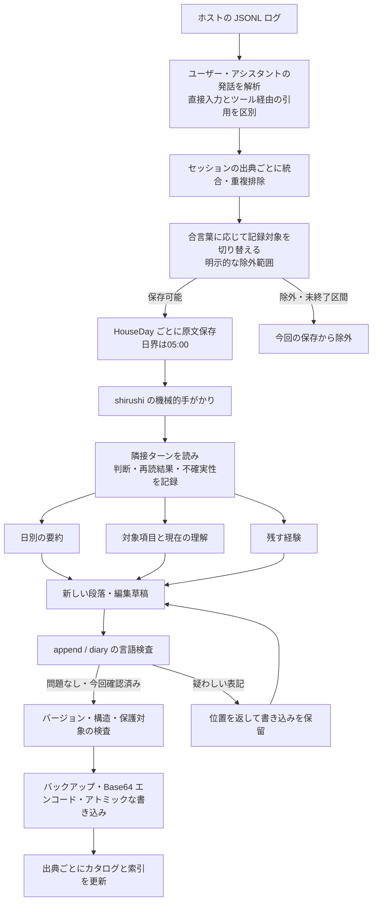
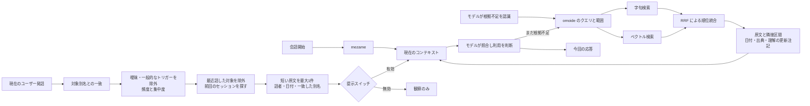
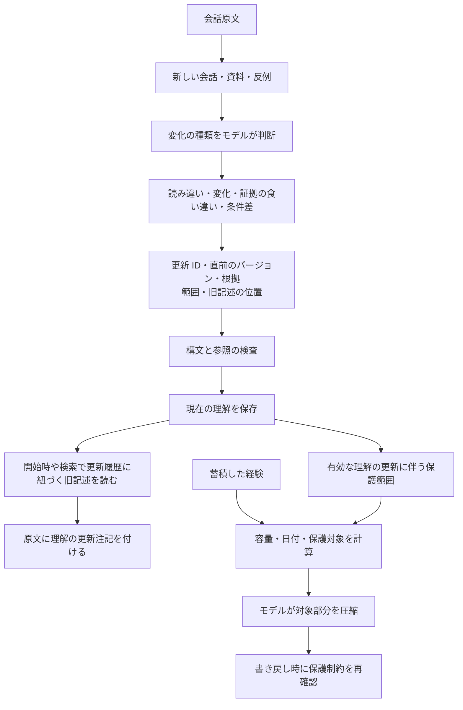
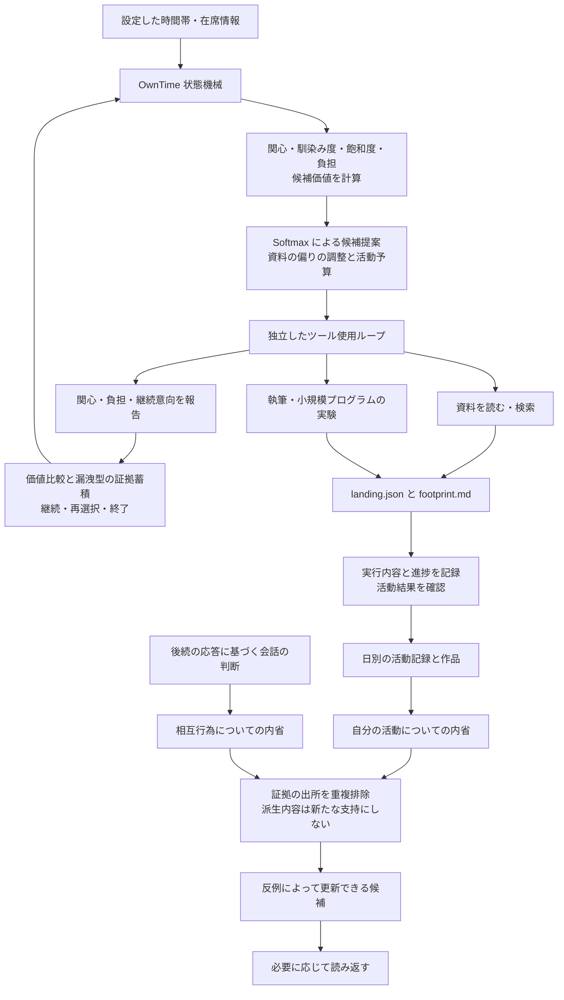

# データ構造と詳細フロー

[中文](../architecture.md) · [English](../en/architecture.md) · **日本語** · [トップ](../../README.ja.md)

## 役割分担

ホストモデルは理解、取捨選択、表現を担当し、ツールは保存、位置の特定、明示されたデータ形式や参照範囲の検査を担当します。意味の正しさを一括判定するスコアは設けていません。機械的な手がかり、CA 判断、検索関連度、内省の証拠、圧縮時の保護条件は、それぞれ別のデータとして扱います。

## 新しい経験が残るまで



`HouseDay` は日本時間の05:00で区切る日です。実装上の規則であり、JSON の設定では変更できません。記録を停止・再開する合言葉は、対象となるユーザー入力全体と照合します。クライアント、提供事業者、他のバックアップからメッセージを削除する機能ではありません。

### 主な記録形式

以下は実際の記憶を使わずに作成した書式例です。フィールド名はパーサーが認識する構文の一部なので、翻訳せずに使ってください。

**現在の理解の項目**：見出しと別名を手がかりに対象を探し、説明と発話の引用に理解と根拠を記録します。理解の更新履歴も各項目の中に保存します。

```markdown
## もの
### 例の対象
- 別名：青い箱、収納箱
- 説明：机の横に置く箱。
- 日付：2026-10-30
```

**蓄積した経験**：`## むかし`、`## すこし前`、`## このごろ` が3層で、内部は日付で整理します。`（ねゆき）` と `（いけび）` は指定元が異なる保持マーカーです。保持・追記・圧縮の制約は `Memory/Strobe.hs`、`FadePolicy.hs`、`Store/EditPlan.hs` が扱います。

**会話の振り返り**：`## ひととき` がセッションのブロック、`###` が位置を示し、`判：`、`再読：`、`しるし：` に初回の判断、再読結果、手がかりの検証結果を保存します。判断を書くのはモデルです。ツールは保存済みの判断を読み、誤りと判定した手がかりによる加点が残らないようにします。

**再構築可能なカタログ**：出典、日、セッション、話者、区間の位置、内容のフィンガープリントを記録し、対象項目を別名の出現位置と結びます。カタログは新たな事実の出典でも、すべての関連を因果関係として扱う知識グラフでもありません。

## 3つの想起経路の合流



表現や意味が似ているだけでは、その記憶が現在の会話で役立つとは限りません。「前回この語が出た」だけでは同じ対象とも限りません。モデルが対象、時刻、文脈を確かめる余地を残します。

集中度の計算では1日を1文書として扱います。文字列の出現頻度に対する出現日数を求め、コーパス内の基準分布で補正します。一般的な使用頻度が不明な別名や、出現回数が少ない別名には、誤って除外しないための例外を設けています。自動連想のトリガー選別だけに使い、元の運用環境で選んだ閾値が他の人の記録でも最適とは限りません。

## 理解の更新と記憶の圧縮



書き込み保護は、全ファイルを永久に不変にすることではありません。経験の追加、通常の更新、局所的な表記修復、圧縮には別の入口があります。`--force` は通常の言語チェックを一括で無効化する引数ではありません。`--lang-ok` はその呼び出しの言語確認だけに作用し、コアのバージョン検査や内容保護は飛ばせません。

## 自主活動と内省



規則に従って状態が変化する活動状態機械と、モデルによる判断を組み合わせています。`_ayame.py` の出典分類や候補生成は外部モデルを呼びます。空のテンプレートだけでは、元の運用環境のペルソナ、読書計画、スケジュールは再現されません。完全なフィールド定義は `OwnTime/Reflection.hs`、`Michikusa.hs`、`Records.hs`、`Types.hs`、`Tokimori.hs` を参照してください。

活動価値、抽選、継続・終了の蓄積、検索、集中度、証拠の集計は[数理モデルとパラメータ](mechanisms.md)にまとめています。
