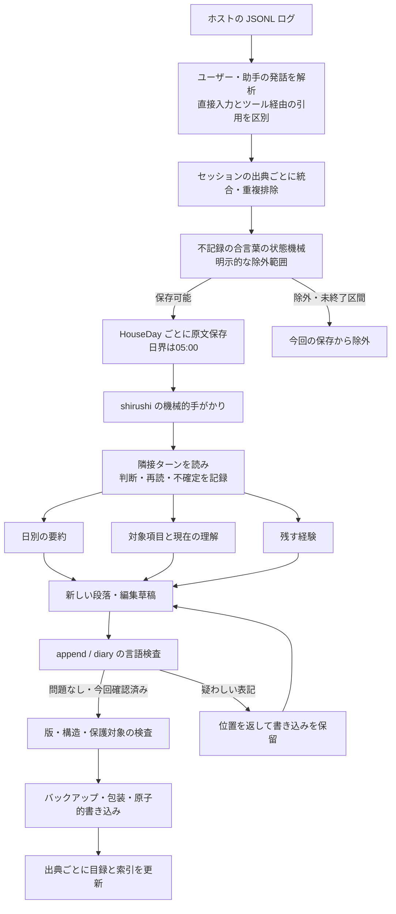
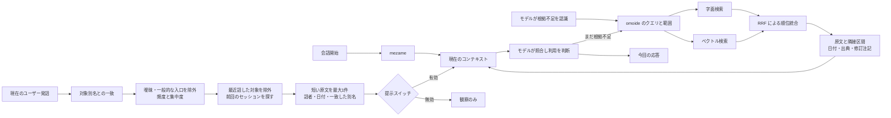
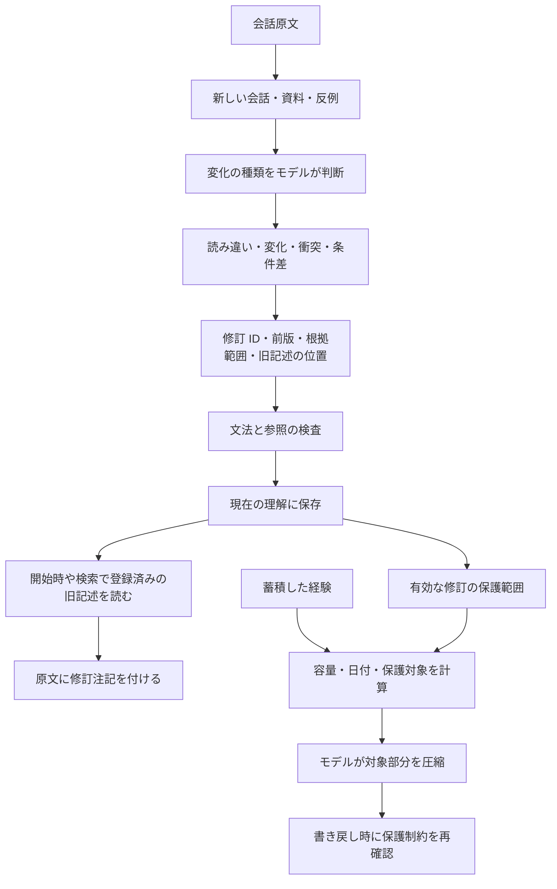
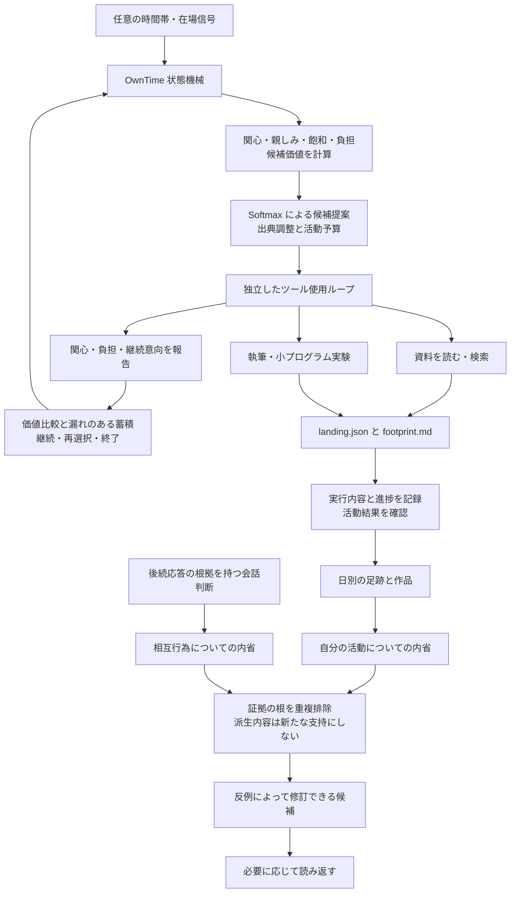

# データ構造と詳細フロー

[中文](../architecture.md) · [English](../en/architecture.md) · **日本語** · [トップ](../../README.ja.md)

## 役割分担

ホストモデルは理解、取捨選択、表現を担当し、ツールは保存、位置の特定、明示された構造的境界の検査を担当します。意味の正しさをすべて判定する総合点はありません。機械的な手がかり、CA 判断、検索関連度、内省の証拠、圧縮保護は別々のデータです。

## 新しい経験が残るまで



`HouseDay` は日本時間の05:00で区切る日です。現在は実装上の約束であり、JSON で任意変更する項目ではありません。不記録の合言葉は条件を満たすユーザー入力全体に一致させます。クライアント、提供事業者、他のバックアップからメッセージを削除する機能ではありません。

### 主な記録形式

以下は合成した構造例です。フィールド名は構文なので、見た目のために翻訳して書き戻さないでください。

**現在の理解の項目**：見出しと別名が対象を見つける入口になり、説明と原話が理解と根拠を持ちます。修訂は項目の内部に置きます。

```markdown
## もの
### 例の対象
- 別名：青い箱、収納箱
- 説明：机の横に置く箱。
- 日付：2026-10-30
```

**蓄積した経験**：`## むかし`、`## すこし前`、`## このごろ` が3層で、内部は日付で整理します。`（ねゆき）` と `（いけび）` は出所の違う保留マーカーです。保留・追記・圧縮の制約は `Memory/Strobe.hs`、`FadePolicy.hs`、`Store/EditPlan.hs` が扱います。

**会話の振り返り**：`## ひととき` がセッションのブロック、`###` が位置を示し、`判：`、`再読：`、`しるし：` が初判・再読・手がかりの確認を保存します。判断を書くのはモデルです。ツールは既存判断を読み、誤りと判定した手がかりが採点に残らないようにします。

**再構築可能な目録**：出典、日、セッション、話者、区間位置、内容指紋を記録し、対象項目を別名の出現位置と結びます。目録は新たな事実の出典でも、すべての関連を因果と扱う知識グラフでもありません。

## 3つの想起経路の合流



字面や意味の類似は、現在の会話に追加の役割を持つことの証明ではありません。「前回この語が出た」だけでは同じ対象とも限りません。モデルが対象、時刻、文脈を確かめる余地を残します。

集中度は日を文書単位とし、文字列の頻度と出現日の数を、コーパス内の基準分布で補正します。一般頻度不明や低頻度の別名は現行の保守的な扱いに従います。自動連想の入口だけに作用し、元の運用環境で選んだ閾値が他の人の記録でも最適とは限りません。

## 修訂と淡化



書き込み保護は、全ファイルを永久に不変にすることではありません。経験の追加、通常の修訂、局所的な表記修復、圧縮には別の入口があります。`--force` は日常の言語警告を一律に迂回する引数ではありません。`--lang-ok` はその呼び出しの言語確認だけに作用し、コアの版検査や内容保護は飛ばせません。

## 自主活動と内省



決定的な活動状態機械とモデル判断を組み合わせています。`_ayame.py` の出典分類や候補生成は外部モデルを呼びます。空テンプレートに元の人格、読書計画、スケジュールが再現されるわけではありません。完全なフィールド定義は `OwnTime/Reflection.hs`、`Michikusa.hs`、`Records.hs`、`Types.hs`、`Tokimori.hs` を参照してください。

活動価値、抽選、継続・終了の蓄積、検索、集中度、証拠の計数は[数理モデルとパラメータ](mechanisms.md)にまとめています。
