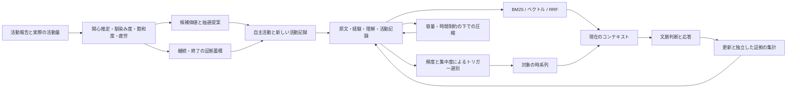

# 意思決定と記憶の数理モデル

[中文](../mechanisms.md) · [English](../en/mechanisms.md) · **日本語** · [トップ](../../README.ja.md)

公開ソースに実装されている計算を説明します。既定値は実際の運用に応じて見直すことを想定した設計値であり、人を対象に測定した心理学的な定数ではありません。モデルが関心、負担、意向、文脈判断を入力し、プログラムが状態更新、候補抽選、予算、構造制約を担当します。

## I. 自主活動：状態を持つ選択と継続

主な実装は [Engine.hs](../../.tools/haskell-src/src/Hikaru/OwnTime/Engine.hs) と [Fatigue.hs](../../.tools/haskell-src/src/Hikaru/OwnTime/Fatigue.hs) です。資料ごとの状態に加え、活動全体の疲労、負担を考慮した活動時間、継続判断の累積値、資料の由来別の活動台帳を保持します。

### 1. 候補価値：関心・馴染み度・飽和度・負担

候補資料 i に対して：

$$
V_i = I_i + w_F F_i - S_i - \lambda e_i^2
$$

| 量 | 意味 | 出所 |
|---|---|---|
| I | 関心の推定、0〜1 | 接触後のモデル報告と履歴からの推定 |
| F | 馴染み度、0〜1 | 同じ資料への接触履歴 |
| S | 飽和度（同じ資料への接触による飽きの度合い）、0〜1 | 接触中に増え、離れると低下 |
| e | 負担の強さ、0〜1 | 報告、または欠測理由を伴う推定 |
| λ | 現在の負担のコスト係数 | 短期疲労と日内累積 |
| w_F | 馴染み度の正の寄与 | 既定値0.3 |

以前から関心のある資料でも、馴染みがあるために選びやすくなる一方、続けて触れることで一時的に魅力が下がることがあります。負担は二乗項で価値から差し引かれるため、疲労時には負担の大きい資料ほど選ばれにくくなります。V は候補の選択と比較に使う実装上の指標です。

### 2. 過去の報告から関心と負担を更新する

`estimateAt` は中立の事前値を加え、古い観察ほど重みを下げた加重平均を計算します。

$$
w_j=2^{-\Delta\mathrm{days}_j/14},\qquad
\hat\mu=\frac{0.5+\sum_j w_j y_j}{1+\sum_j w_j}
$$

新規候補の関心・負担はともに0.5を既定値とします。観察が入ると報告で更新し、古い観察の重みが下がるにつれて0.5へ戻ります。観察が全くなければ関数は欠測を返し、呼び出し側が資料の既存推定値か新規候補の既定値を使います。

**欠測を0で埋めません。** 質問していない、回答がない、中断した場合は理由付きで推定値に戻せますが、その値を新しく得た報告として記録しません。事前値への縮約を伴う点推定であり、信用区間の計算や言語モデルの重み更新はしていません。

### 3. 馴染み度と飽和度は異なる速さで変わる

新たな接触として数えられる機会が1回あったとき：

$$
F^+=F+a_F(1-F),\qquad S^+=S+a_S(1-S)
$$

既定は a_F = 0.08、a_S = 0.10 です。同じ資料を指す入口が複数あっても、それぞれを独立した候補としては扱いません。

馴染み度は実際の経過時間に応じて減衰します。資料に触れている間も減衰は計算します。

$$
F(t+d)=F(t)\,2^{-d/(21\times1440)}
$$

この式と以下の式では、d は分単位です。離れている間の飽和度の半減期は2日です。

$$
S(t+d)=S(t)\,2^{-d/(2\times1440)}
$$

接触が続くと、飽和度は平衡値へ近づきます。

$$
a=\frac{\ln2}{360},\quad b=\frac{\ln2}{2\times1440},\quad
S_{eq}=\frac{a}{a+b}=\frac89
$$

$$
S(t+d)=S_{eq}+(S(t)-S_{eq})e^{-(a+b)d}
$$

F と S は**活動資料の状態**であり、会話原文の削除・保持・信頼性を決める値ではありません。

### 4. 短期疲労・日内累積・予算

活動時間 d に負担の強さ e を掛けた ΔE = e·d を、負荷換算時間として計上します。以降、この単位を「負荷換算分」と表記します。短期疲労 R の作業時・休息時の更新は次の通りです。

$$
R_{work}=1-(1-R)2^{-\Delta E/60},\qquad
R_{rest}=R2^{-d/25}
$$

1日の活動を通じて、よりゆっくり変化する累積状態：

$$
U_{live}=1-(1-U_m)2^{-E_{day}/120}
$$

負担のコスト係数は、この2つの状態に応じて変わります。

$$
\lambda=0.5+2(R+U_{live})
$$

その日の開始値 U_m は、回復後の U、前日までの予算超過分を表す D/120、その日1回の自己報告による状態値のうち、最大の値です。自己報告の欠測を0にせず、繰り返し尋ねて都合のよい値を選ぶこともできません。その日の最初に実際の活動量を計上するときに開始値を固定します。

1日の基本予算は B_day = 120(1−U_m) です。予算を超えた負荷換算時間は「負債」として持ち越し、その上限は120です。夜間の条件を満たす静かな時間に、U は180分、負債は240分の半減期で減少し、回復後に5未満の負債は0にします。日中の短い休息は主に R を回復させ、その日に計上した活動量をリセットしません。

読書には別に1日480換算分の上限があります。現在の区間で許される読書量は：

$$
Q=\max\left(0,\min(25-A_{advance},\;480-T_{read},\;E_{room})\right)
$$

- A_advance は、すでに提示した読書量のうち、実時間の経過でまだ相殺されていない分で、資料別のキューに保持します。
- T_read は当日の使用済み換算読書時間です。
- E_room は許容される予算超過の範囲も含めた、残りの負荷換算時間です。

読書量と負荷換算時間は、資料を提示した時点で1回だけ計上します。その後に実時間が経過しても二重計上しません。中断、再起動、日付の変更によって先に提示した分が消えることもありません。執筆や制作も活動予算を消費しますが、読書枠は消費しません。そのため、読書枠を使い切っても、他の活動はできる場合があります。

既定の換算速度は日本語650字/分、中国語390字/分、英語250語/分で、文体係数もあります。これは予算管理のための換算であり、入力の一部はエージェントの報告に依存するため、実際の理解度を測るものではありません。

### 5. Softmax 抽選：候補を提案する

温度 τ = 0.175 に加え、資料の偏りを調整する係数 g_i を別に計算して使います。

$$
P(i)=\frac{g_i\exp(V_i/\tau)}{\sum_j g_j\exp(V_j/\tau)}
$$

数値的に安定した softmax と乱数シードで候補を1つ抽選し、候補表・価値・重みをエージェントに渡します。**提案であって、抽選結果を受け入れる義務ではありません。**

この調整は、自主活動がユーザー関連の資料だけに偏らないようにするためのものです。A_rel をユーザー関連資料に費やした負荷換算時間の加重合計、B_known を由来が分かっている全資料に費やした負荷換算時間の加重合計とすると：

$$
E_{src}=A_{rel}-0.2B_{known}
$$

$$
g=1-\frac23\mathrm{clip}_{[0,1]}(E_{src}/100)
$$

ユーザー関連候補は g、他は1を使います。関連する候補の重みは元の3分の1までしか下げず、選択自体は禁止しません。由来が分からない資料の活動量は別に記録し、「ユーザーと無関係」とは扱いません。台帳の半減期は2.5日で、活動中に加わる時間についても、実際に活動した時刻を考慮して減衰量を積分します。

実装では抽選に使うロジットの計算において、価値に τ·ln(g) を加え、上の乗算と等価にしています。この係数は**候補の提示頻度だけ**を変え、関心そのものや、以下の継続・停止の証拠には入りません。

### 6. 続けるか離れるか：漏洩型の証拠蓄積

活動中の各判断時点で、現在の資料を実行可能な別候補と比較します。

別候補は資料の偏りの調整を加えない softmax で重み付けし、「次回接触した後」の状態 V_i⁺ で比較します。休息の価値は0です。

$$
V_{else}=\max\left(0,\sum_i p_i V_i^+\right)
$$

別候補がなければ V_else = 0。次の段階が新規接触になる資料にだけ `newContact` を適用し、同じ資料を指す複数の入口は先にまとめます。

各判断時点の証拠値 m は、継続意向と価値差から求めます。

$$
z=\tanh\left(\frac{V_{here}-V_{else}}{0.25}\right),\qquad
m=0.25s_{self}+0.75z
$$

明示的に続けたい・もう一度見たいなら s_self = 1、分からないなら0です。意向報告がなければ直接 m = z とし、「分からないと報告した」とは分けます。「もう十分」「先に休む」は蓄積の閾値を待たず終了します。

実際に活動した時間 d に対して：

$$
\rho(d)=2^{-d/60},\qquad K=\frac{0.5}{1-2^{-25/60}}
$$

$$
x'=\mathrm{clip}_{[-1,1]}\left(\rho(d)x+K[1-\rho(d)]m\right)
$$

一時停止中は以前の x を減衰させるだけで、新しい証拠を加えません。m が一定の区間では、時間を細かく区切っただけで結果が変わらない積分形です。追加のランダム拡散項はなく、主なランダム性は候補抽選にあります。

x ≤ −0.15 になると、初回は選び直しを求めます。それでも続けるなら x を0に戻し、再選択の機会を使ったことを記録します。2回目の到達で終了します。プログラムが蓄積を管理し、関心・負担・意向の意味判断はエージェントが行います。

### 7. 既定パラメータ

| 系統 | パラメータ | 既定値 |
|---|---|---|
| 価値・抽選 | w_F、τ | 0.3、0.175 |
| 関心・負担推定 | 事前平均/重み、観察の半減期 | 0.5 / 1、14日 |
| 馴染み度・飽和度 | 新規接触増分 a_F / a_S | 0.08 / 0.10 |
| 馴染み度・飽和度 | F 半減期、離れているときの S 半減期、接触増加スケール | 21日、2日、360分 |
| 疲労 | 作業/休息半減期、1日の基本活動予算 | 60負荷換算分 / 25分、120負荷換算分 |
| 日内回復 | U / 負債半減期、回復に算入する静かな時間の1日あたりの上限 | 180 / 240分、480分 |
| 枠 | 区間長、1日の読書上限、負債上限 | 25分、480換算分、120負荷換算分 |
| 継続・終了 | α、v₀、H_x、η_x、終了閾値 | 0.25、0.25、60分、0.5、−0.15 |
| 資料の偏りの調整 | 半減期、基準割合、超過スケール、重み下限 | 2.5日、0.2、100分、1/3 |

実行側には、1回の活動を最大6区間とする上限や、読書・執筆・制作などの実績がない区間が続いた場合、起動に失敗した場合などの停止条件もあります。[Trigger.hs](../../.tools/haskell-src/src/Hikaru/OwnTime/Trigger.hs)を参照してください。既定値は `Fatigue.defaultParams` に集約されていますが、すべてがユーザー設定の JSON から変更できるわけではありません。

## II. 記憶：検索・トリガー・証拠・圧縮を別々に計算する

### 1. 能動検索：文字 BM25・ベクトル・RRF

[omoide.py](../../.tools/omoide.py) の字句検索は文字2-gram を使います。クエリの2-gram q に対して：

$$
\mathrm{idf}(q)=\ln\left(1+\frac{N-df(q)+0.5}{df(q)+0.5}\right)
$$

$$
L(d)=\sum_{q\in Q}\mathrm{idf}(q)
\frac{tf(q,d)(k_1+1)}{tf(q,d)+k_1(1-b+b|d|/\overline{|d|})}
$$

既定は k₁ = 1.5、b = 0.75。クエリの各語が区間内に完全一致する場合、その語に対してさらに2点を加えます。

[_embed.py](../../.tools/_embed.py) は正規化ベクトルの内積を使います。長い区間は400字・重なり60字の窓に分割し、窓とクエリベクトルの組み合わせの最大値を区間の得点にします。既定は BGE-M3。その検索で最も高い意味検索スコアから0.10以内の候補だけを取り、候補数にも上限があります。

各経路から最大 `max(30, 5 × top)` 件を取り、順位を統合します。

$$
\mathrm{RRF}(d)=\sum_{r:\ d\in r}\frac{1}{60+\mathrm{rank}_r(d)}
$$

順位は1始まりです。ある経路で見つからなかった候補には、その経路の得点は加わりません。異なる尺度の生得点は直接加算しません。原文区間、日付、出典、適用される理解の更新注記を返します。**検索スコアは、内容が事実として正しい確率を表すものではありません。**

### 2. 連想のトリガー：一般的な使用頻度とローカルな集中度

[_koyori.py](../../.tools/_koyori.py) は日を文書単位にします。会話があった N 日分のコーパスで、文字列が cf 回、df 日に出現するとき、一様かつランダムに分布すると仮定したポアソンモデルの期待出現日数は次の通りです。

$$
E(cf)=N\left(1-e^{-cf/N}\right)
$$

固定した乱数シードを使い、長さが2〜4字の異なる文字列を最大3,000個抽出します。3回以上現れる参照文字列を floor(log₂ cf) でビン分けし、少なくとも5サンプルを含むビンで次を計算します。

$$
u_b=\mathrm{median}_{s\in b}\frac{df_s}{E(cf_s)}
$$

偶数個の場合、コードは並べた中央2値の上側を使います。別名には最も近い利用可能な頻度ビンを使います。

$$
C(a)=\ln\left(\frac{E(cf_a)u_b}{df_a}\right)
$$

C が0に近いと同頻度のコーパス基準に近く、大きいほど少数の日に集中しています。ポアソンモデルを参照とし、経験的基準でコーパス全体の分布の偏りを補正します。

「一般的で分散している」という理由でその別名を自動連想のトリガーから除外するのは、次の全条件を満たす場合だけです。

$$
cf>6\quad\land\quad G\ge4.0\quad\land\quad C<0.25
$$

G は [_yonotsune.py](../../.tools/_yonotsune.py) の一般的な使用頻度の推定値です。候補言語ごとに分割し、最も稀な構成要素の wordfreq Zipf 値を取り、候補言語間では最大値を採用します。仮名があれば日本語、漢字がなくラテン文字があれば英語、それ以外は中国語と日本語を比較します。頻度不明、集中度の基準不足、出現回数不足ではこの条件による除外はしません。

近似には限界があります。よく使われる語を組み合わせた、当事者間だけで意味を持つ表現でも G が高くなり、集中は経験だけでなく言語切替からも生じます。**現在の `clumping()` は同頻度のコーパス基準を使い、字種別の背景モデルを別途当てはめてはいません。** 一般的な使用頻度を調べる際の言語選択と、言語切り替えが集中度に与える影響の補正は別の処理です。後者はまだ実装していません。

複数項目で共通する別名や、別項目の別名の末尾と一致する場合などの曖昧さは別に処理します。自動連想のトリガーだけを選別し、記憶の削除や能動検索の禁止はしません。

過去の語彙実験、1,891発話のリプレイ、誤って除外する代償、統計上の限界は[既知の制約](limitations.md)を参照してください。ある分類での高い保持率は全体の分類精度ではなく、リプレイ結果も新しい記録へ直接外挿できません。

### 3. どの経験を提示するか：時系列から探す

現在の [timeline()](../../.tools/_taguri.py) の主経路は：

1. 現在の発話と対象別名を照合し、検索条件を満たす直近6件の発話ですでに言及された対象を除く。
2. 保存原文から同じ別名の位置を探し、現在のコンテキストの時刻より前に限定する。
3. 複数の対象が一致したら、カタログでの出現数が少ないものを優先する。
4. 直近のセッションを見つけ、その中を字句検索の関連度で順位付けする。同点なら新しい区間を取る。
5. 約120字の短い区間を最大1件渡し、モデルが利用を判断する。

全体で最も似た文を選ぶことを「前回起きたこと」の代わりにはしません。ただし時系列で確認できるのも語の出現であり、同じ対象を指していることを文字列だけでは保証できません。

フックの観察専用モード用に、古い候補順位付けも残っています。

$$
T(d)=2^{-\mathrm{ageDays}/30}+\mathrm{importance}(d)+\mathrm{relevance}(d)
$$

字句・意味検索の関連度を別々に閾値判定・正規化し、大きい方を取ります。**現在のフックの提示スイッチにつながるのは時系列経路だけで、この旧総得点は現行の提示判定ではありません。** 能動検索 `omoide` も、RRF の代わりにこの3項和を使うことはありません。

### 4. 重要度：既存の CA 判断を機械的な手がかりに反映する

`imp-v2` は規則による得点で、モデルに各区間の抽象的な重要度を自由に採点させるものではありません。

| 出所 | 点 |
|---|---:|
| 保護された経験と対応する原文 | 1.0 |
| ユーザー発話の訂正候補 | 0.8 |
| ユーザー発話の言い淀み・喜び候補 | 0.7 |
| 他の信号なし | 0.2 |

複数あれば最大値を取ります。文脈判断が手がかりを明示的に否定していれば、先にその手がかりを除きます。手がかりが妥当と確認されても元の点を維持するだけで、追加では加点しません。信頼できる判断がなければ、結論を補いません。実装は `_koyori.apply_verdicts` です。

カタログと関連する候補処理のための値であり、「0.7の記憶は0.2の記憶より正確だ」とは言えず、現在の時系列検索が必ず高得点の区間を選ぶとも言えません。

### 5. 内省：証拠を集合として数え、再浮上と支持を分ける

[_ayame.py](../../.tools/_ayame.py) は `surfaced`（再浮上）と `evidence`（支持・反例・更新）を分けます。同じ証拠に由来する支持は重複して数えません。元の内省から派生した資料を読んで賛同しただけなら再浮上として記録します。再読から反例や更新が出た場合は登録でき、再読由来だからと訂正を排除しません。

`standing()` は明示的な計数条件を次の順で判定します。

| 状態 | 条件の要約 |
|---|---|
| 書き直しが必要 | 後から加わった更新が3件以上あり、その件数が後から加わった支持の件数以上 |
| 不安定 | 反例数が支持数以上 |
| 比較的安定 | 支持が得られた日が4日以上あり、反例数×4が支持数未満、更新数も支持数未満 |
| 未定 | その他 |

支持・反例は実装の重複排除キーで数えます。派生した反例・更新は再読イベントとして数え、外部から得た新たな支持の証拠としては扱いません。同じ日に複数の支持があっても、支持が得られた日数としては1日と数えます。

これは内容を確認できる明示的な状態判定規則で、確率として校正された確信度ではありません。後続応答が支持・反例・更新なのか、単に同じ事柄への言及なのかはモデルが判断します。

### 6. 忘却：容量・日付条件・保護制約

[FadePolicy.hs](../../.tools/haskell-src/src/Hikaru/Memory/FadePolicy.hs) の既定値：

| 移動 | 圧縮を開始する容量条件 | 日付条件 |
|---|---:|---|
| このごろ → すこし前 | このごろが30,000字を超える | 現在の HouseDay から31日前の日付より前 |
| すこし前 → むかし | すこし前が15,000字を超える | 同上 |

文字数は見出しなどの構造用文字も含めた各層のテキストから、先頭・末尾の空白を除いて数えます。[planFade](../../.tools/haskell-src/src/Hikaru/Memory/Fade.hs) は保存されている順に日付ごとの節をたどり、容量の超過分に達するまで対象を選びます。日付条件を満たさない節に達すると選択を止め、全記録から確率的に削除するわけではありません。

選ばれた内容をモデルが整理し、書き戻し時に対象外部分、保持マーカー、理解の更新に伴う保護などを再確認します。原文は残ります。自動想起の回数を一律に保持期間の延長へ換算する仕組みではありません。

## III. 各計算のつながり

活動選択、記憶の関連度、証拠の支持、保持方針は、それぞれ異なる計算を使います。プログラムが履歴の変化を追えるようにし、どの経験から新しい理解を作るか、今どう話すかはモデルの判断として残します。
