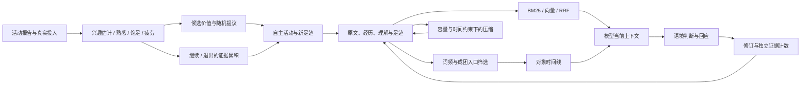

# 决策与记忆中的数学模型

本文对应当前发布源码中的计算。默认参数是工程设计值，使用者可以据实际运行重新评估；它们不是从使用者身上测出的心理常数。模型提供兴趣、负担、意愿和语境判断等输入，程序负责状态更新、候选抽样、预算与结构约束。

## 一、自由活动：带状态的选择与继续机制

代码主要在 [`Engine.hs`](../.tools/haskell-src/src/Hikaru/OwnTime/Engine.hs) 和 [`Fatigue.hs`](../.tools/haskell-src/src/Hikaru/OwnTime/Fatigue.hs)。每份材料有自己的状态，活动过程还维护疲劳、投入时间、当前意愿累积和材料来源账本。

### 1. 候选价值：兴趣、熟悉、饱足与负担

对候选材料 i：

$$
V_i = I_i + w_F F_i - S_i - \lambda e_i^2
$$

| 量 | 含义 | 来源 |
|---|---|---|
| I | 兴趣估计，0 到 1 | 接触后的模型报告及其历史估计 |
| F | 熟悉程度，0 到 1 | 对同一材料的接触历史 |
| S | 饱足程度，0 到 1 | 接触时积累，离开后逐渐下降 |
| e | 负担强度，0 到 1 | 报告或带缺失原因的估计 |
| λ | 当前负担的代价系数 | 短期疲劳与日内累积状态 |
| w_F | 熟悉带来的正贡献 | 默认 0.3 |

这样，一份曾经喜欢的材料可以因熟悉而更容易接近，也可能因连续接触而暂时失去吸引力。负担通过平方项进入价值；疲劳增加时，高负担材料受到更大影响。V 是供选择和比较使用的工程量。

### 2. 从历史报告更新兴趣与负担

`estimateAt` 对历史观察使用带中性先验的衰减加权平均：

$$
w_j=2^{-\Delta\mathrm{days}_j/14},\qquad
\hat\mu=\frac{0.5+\sum_j w_j y_j}{1+\sum_j w_j}
$$

新候选默认兴趣和负担均为 0.5。有观察后，估计由报告更新；旧观察逐渐减弱，估计向 0.5 回归。完全没有观察时函数返回缺失，由调用方使用材料已有估计或新候选默认值。

**缺失不填成 0**。没有询问、没有回答或被打断时，可以带原因回退到估计，但回退值不再伪装成一次新的实际报告。这里是带先验收缩的点估计，没有计算可信区间，也没有更新语言模型权重。

### 3. 熟悉与饱足有不同的变化速度

一次真正的新接触：

$$
F^+=F+a_F(1-F),\qquad S^+=S+a_S(1-S)
$$

默认 a_F = 0.08、a_S = 0.10。重复登记同一材料的入口不会被当作多份独立候选。

熟悉度按日历时间衰减，接触期间也计算这部分时间：

$$
F(t+d)=F(t)\,2^{-d/(21\times1440)}
$$

下列式子中的 d 以分钟计。离开材料后，饱足的半衰期为 2 天：

$$
S(t+d)=S(t)\,2^{-d/(2\times1440)}
$$

持续接触时，饱足向一个平衡值靠近：

$$
a=\frac{\ln2}{360},\quad b=\frac{\ln2}{2\times1440},\quad
S_{eq}=\frac{a}{a+b}=\frac89
$$

$$
S(t+d)=S_{eq}+(S(t)-S_{eq})e^{-(a+b)d}
$$

F 和 S 是**活动材料的状态**，不决定聊天原文的删除、保留或可信程度。

### 4. 短期疲劳、日内累积与预算

一次活动的投入量为 ΔE = e·d，单位是“努力分钟”。短期疲劳 R 的工作与休息更新分别是：

$$
R_{work}=1-(1-R)2^{-\Delta E/60},\qquad
R_{rest}=R2^{-d/25}
$$

日内较慢的累积状态：

$$
U_{live}=1-(1-U_m)2^{-E_{day}/120}
$$

负担代价随两者变化：

$$
\lambda=0.5+2(R+U_{live})
$$

一天的起点 U_m 综合恢复后的 U、已有超额投入债务 D/120 和当天一次性的状态自评，取其最大值。自评缺失时不补 0；重复询问也不能反复挑一个更有利的数。起点在当天第一次实际投入时冻结。

日基础预算 B_day = 120(1−U_m)。用超的努力进入债务，债务上限 120；夜间符合条件的安静时间使 U、债务分别按 180、240 分钟的半衰期下降。小于 5 的债务在恢复后归零。日内短休主要恢复 R，不把整天的投入清空。

阅读额度还有独立的日上限 480 个折算分钟。当前片段允许的阅读量是：

$$
Q=\max\left(0,\min(25-A_{advance},\;480-T_{read},\;E_{room})\right)
$$

- A_advance 是已交付、尚未由流逝时间承接的阅读量，按材料保留队列。
- T_read 是当天已用的折算阅读时间。
- E_room 是当前剩余努力额度，包含实现允许的有限债务空间。

交付时计阅读量与努力一次；之后用流逝时间承接时不重复扣费。暂停、重启或换日不会凭空清掉这笔先行量。写作和制作也计努力，但不消耗阅读额度；因此“不能再读”不等于“不能做其他活动”。

阅读折算采用当前默认速度：日语 650 字/分钟、中文 390 字/分钟、英语 250 词/分钟，另有文体速度系数。它是预算口径，输入仍部分依赖代理报告，不是对模型实际阅读理解程度的测量。

### 5. Softmax 抽样：决定递哪些候选

基础候选权重由 softmax 给出，温度 τ = 0.175。还有一个独立的来源平衡系数 g_i：

$$
P(i)=\frac{g_i\exp(V_i/\tau)}{\sum_j g_j\exp(V_j/\tau)}
$$

使用稳定的 softmax 实现计算，并根据随机种子抽出一个候选；候选表、价值和权重会提供给代理。**这是候选提议，不是强制她接受抽中的材料。**

来源平衡希望自主活动保留一定的自主范围。令 A_rel 是与用户相关的加权投入分钟，B_known 是来源已知的全部加权投入分钟：

$$
E_{src}=A_{rel}-0.2B_{known}
$$

$$
g=1-\frac23\mathrm{clip}_{[0,1]}(E_{src}/100)
$$

用户相关候选使用 g，其余使用 1，所以相关候选权重最多降到原先的三分之一，不会被彻底禁止。来源不明的投入单独记账，不冒充“无关”。来源账本半衰期为 2.5 天，活动期间加入的分钟也按发生时间积分衰减。

实现将 τ·ln(g) 加到抽样 logits 使用的价值上，与上面的乘法权重等价。这个系数**只改变候选曝光**，不改写兴趣本身，也不进入后面的继续/停止证据。

### 6. 继续还是离开：带泄漏的证据累积

每个实际活动节点比较当前材料与其他可行候选。

其他候选先按未加来源平衡的 softmax 加权；比较值使用“下一次接触之后”的状态 V_i⁺，并把休息的价值设为 0：

$$
V_{else}=\max\left(0,\sum_i p_i V_i^+\right)
$$

没有其他候选时 V_else = 0。只有下一步构成新接触的材料才应用 `newContact`，同一材料的多个入口先去重。

节点证据 m 将模型意愿和价值差合在一起：

$$
z=\tanh\left(\frac{V_{here}-V_{else}}{0.25}\right),\qquad
m=0.25s_{self}+0.75z
$$

明确愿意继续/再看时 s_self = 1，拿不准时为 0；没有意愿报告时直接用 m = z，区别于“她报告了拿不准”。“已经够了”或“先休息”直接退出，不必等累计值过线。

对实际经过的活动时间 d，累积器更新为：

$$
\rho(d)=2^{-d/60},\qquad K=\frac{0.5}{1-2^{-25/60}}
$$

$$
x'=\mathrm{clip}_{[-1,1]}\left(\rho(d)x+K[1-\rho(d)]m\right)
$$

暂停时只有旧 x 衰减，不加入新证据。在同一个 m 持续的区间内，这个积分写法避免仅因把时间切成更多小段而改变累积结果。它没有额外的随机扩散项；随机性主要来自候选抽样。

当 x ≤ −0.15，第一次越线要求重新选择；若仍选择继续，则 x 归零并记下已用过这次重选机会。第二次越线结束这项活动。程序维护累计过程，语义上的兴趣、负担及意愿仍由代理判断。

### 7. 默认参数索引

| 子系统 | 参数 | 当前默认值 |
|---|---|---|
| 候选价值与抽样 | w_F、τ | 0.3、0.175 |
| 兴趣/负担估计 | 先验均值/权重、观察半衰期 | 0.5 / 1、14 天 |
| 熟悉/饱足 | 新接触增量 a_F / a_S | 0.08 / 0.10 |
| 熟悉/饱足 | F 半衰期、离开时 S 半衰期、接触增长尺度 | 21 天、2 天、360 分钟 |
| 疲劳 | 工作/休息半衰期、基础努力预算 | 60 努力分钟 / 25 分钟、120 努力分钟 |
| 日内恢复 | U / 债务半衰期、每日安静时间计入上限 | 180 / 240 分钟、480 分钟 |
| 额度 | 片段长度、日阅读上限、债务上限 | 25 分钟、480 折算分钟、120 努力分钟 |
| 继续/退出 | α、v₀、H_x、η_x、退出线 | 0.25、0.25、60 分钟、0.5、−0.15 |
| 来源平衡 | 半衰期、参考比例、超额尺度、权重下限 | 2.5 天、0.2、100 分钟、1/3 |

运行者另外有单次活动最多 6 个片段、连续无交付与启动失败等停止条件。这些是调度规则，详见 [`Trigger.hs`](../.tools/haskell-src/src/Hikaru/OwnTime/Trigger.hs)。默认数值集中在 `Fatigue.defaultParams`；当前不是所有数值都已开放成用户 JSON 配置项。

## 二、记忆：检索、入口、证据与压缩分别计算

### 1. 主动检索：字符 BM25 + 向量 + RRF

[`omoide.py`](../.tools/omoide.py) 的字面检索以字符二元组为单位。对查询二元组 q，使用：

$$
\mathrm{idf}(q)=\ln\left(1+\frac{N-df(q)+0.5}{df(q)+0.5}\right)
$$

$$
L(d)=\sum_{q\in Q}\mathrm{idf}(q)
\frac{tf(q,d)(k_1+1)}{tf(q,d)+k_1(1-b+b|d|/\overline{|d|})}
$$

默认 k₁ = 1.5、b = 0.75；每个查询词完整出现在片段中，另加 2 分。这是实际实现中的额外字面奖励。

语义侧在 [`_embed.py`](../.tools/_embed.py) 使用归一化向量的内积。长片段切为 400 字窗口、重叠 60 字；一个片段对查询的分数取其窗口与查询向量组合中的最高值。默认 BGE-M3，候选只取距本次最高语义分不超过 0.10 的部分，并有候选池上限。

各路先取最多 `max(30, 5 × top)` 条，再按排名融合：

$$
\mathrm{RRF}(d)=\sum_{r:\ d\in r}\frac{1}{60+\mathrm{rank}_r(d)}
$$

排名从 1 起。没有进入某路列表就不获得那一路的项；不同分数尺度不直接相加。最终返回原文窗口、日期和来源，并附适用的修订注记。**这些分数是检索依据，不是事实正确率。**

### 2. 联想入口：一般词频与本地成团程度

[`_koyori.py`](../.tools/_koyori.py) 以“天”为文档。某个字串总共出现 cf 次、覆盖 df 天，语料包含 N 个有对话的日子。随机均匀散布的泊松参考覆盖数为：

$$
E(cf)=N\left(1-e^{-cf/N}\right)
$$

再从语料中以固定随机种子抽取最多 3000 个不同的 2～4 字字串。出现至少 3 次的参照字串按 floor(log₂ cf) 分桶；每桶至少 5 个样本，计算：

$$
u_b=\mathrm{median}_{s\in b}\frac{df_s}{E(cf_s)}
$$

代码的偶数样本中位数取排序后靠上的一个。别名使用最近的可用频数桶，并得到：

$$
C(a)=\ln\left(\frac{E(cf_a)u_b}{df_a}\right)
$$

C 接近 0 表示与语料内同频参照相近；越大，越集中在较少的日子。泊松模型提供参照，语料内的经验基准修正整体分布偏差。

当前只有下列条件同时成立，才因“普通且分散”而关闭该别名的自动联想入口：

$$
cf>6\quad\land\quad G\ge4.0\quad\land\quad C<0.25
$$

G 是 [`_yonotsune.py`](../.tools/_yonotsune.py) 的一般词频估计：各候选语言先分词，取最罕见成分的 wordfreq Zipf 值，再取候选语言结果中的最大值。带假名时用日语；带拉丁字母且无汉字时用英语；其余比较中文与日语。词频未知、成团基准不足或出现次数太少时，不以这条条件阻断。

这一步含有近似：常见词拼成的私人说法也可能得到较高 G；成团可能来自经历，也可能来自语言切换。**当前 `clumping()` 使用同频语料基准，没有另外拟合按字种分组的背景模型。** 一般词频的语言选择不能被写成已经解决了成团分数的语言背景校正。

共享别名、别项别名结尾等歧义规则另行处理。这些条件只筛自动联想扳机，不删除记忆，不禁止主动查询。

### 3. 递哪次过去：按时间线定位

当前 [`timeline()`](../.tools/_taguri.py) 的主路是：

1. 匹配当前发言提到的对象别名，排除最近 6 条合格发言里已谈到的对象。
2. 在保存的原文中找同一别名出现的位置，限制在当前上下文时间截点以前。
3. 命中多个对象时，优先目录中出现次数较少的那个。
4. 找它最近的一次会话，再在那次会话内按字面相关性选片段；同分取较新的。
5. 最多递一条约 120 字的片段，由模型决定是否使用。

这不是用全局最高相似度替代“上次发生了什么”。时间线仍只能确认过去出现过这个说法，不能单靠字符串保证同一指称。

源码还保留另一条旧候选排序，用于 hook 的影子观察：

$$
T(d)=2^{-\mathrm{ageDays}/30}+\mathrm{importance}(d)+\mathrm{relevance}(d)
$$

相关性由字面/语义分各自过门后归一化，再取较大者。**当前 hook 只把时间线路径接到递送开关；这个旧总分不是当前自动发话的决定规则。** 主动 `omoide` 也不使用这个三项和代替 RRF。

### 4. 重要度接线：用已有 CA 判断修正机械线索

当前 `imp-v2` 是规则评分，不让模型自由给每段打一个抽象的重要分：

| 来源 | 分数 |
|---|---:|
| 受保护经历及其映射到的原文 | 1.0 |
| 用户发言上的纠正候选 | 0.8 |
| 用户发言上的犹豫/愉快候选 | 0.7 |
| 无其他信号 | 0.2 |

一段有多条线索取最高值。若已有语境判断明确否定某条机械线索，先移除该线索，再取最大值；确认成立只保留原分，不额外叠加。没有可靠结论时不虚构结论。具体实现是 `_koyori.apply_verdicts`。

它服务于目录与有关候选流程；不能据此推导“0.7 的记忆比 0.2 更真实”，也不能据此说当前时间线一定选择更高分片段。

### 5. 反思：证据集合计数，区分再次想起与获得支持

[`_ayame.py`](../.tools/_ayame.py) 分开维护 `surfaced`（再次浮现）与 `evidence`（支持、反例、修订）。同一证据根重复出现，不重复增加支持；读取由原反思派生的材料并赞同它，只记再次浮现。重读后提出反例或修订仍可以登记，不能因为来自重读就把纠正排除掉。

当前 `standing()` 使用明确的计数条件，按以下顺序判断：

| 状态 | 条件摘要 |
|---|---|
| 待重写 | 后续修订至少 3 个，且不少于后续支持数 |
| 不稳固 | 反例数不少于支持数 |
| 较稳定 | 支持分布在至少 4 天；反例数 × 4 小于支持数；修订数小于支持数 |
| 未定 | 其余情况 |

这里的支持/反例以实现定义的去重键统计；派生的反例或修订按其重读事件记，不当作新的外部支持根。同一日的多条支持不会变成多个支持日。

这些是可审阅的状态规则，不是校准过的信念概率。模型仍需判断一段后续回应到底是支持、反例、修订，还是只是提到了同一件事。

### 6. 遗忘：容量触发、时间资格与保护约束

[`FadePolicy.hs`](../.tools/haskell-src/src/Hikaru/Memory/FadePolicy.hs) 的当前默认值：

| 移动方向 | 触发容量 | 日期资格 |
|---|---:|---|
| 最近 → 稍早 | 最近层超过 30,000 字符 | 日期严格早于当前 HouseDay 减 31 天 |
| 稍早 → 过去 | 稍早层超过 15,000 字符 | 同上 |

字符计数来自该层文本（包含结构文字，去掉首尾空白）。[`planFade`](../.tools/haskell-src/src/Hikaru/Memory/Fade.hs) 沿当前存储顺序的日期节选取合格部分，直到覆盖超额；遇到不符合条件的节会停止这次选取，并不是对所有记录按一个概率随意删除。

模型整理选中的内容；写回时再检查非目标部分、保留标记与修订保护等约束。原始对话保留。自动召回次数没有作为统一的“续命”次数乘进这套压缩规则。

## 三、这些计算怎样共同工作

活动选择、记忆相关性、证据支持和保留策略各有自己的计算口径。程序让这些历史变化可追踪；哪些经历值得形成新理解、怎样在当下说出来，仍然保留为模型的判断。
